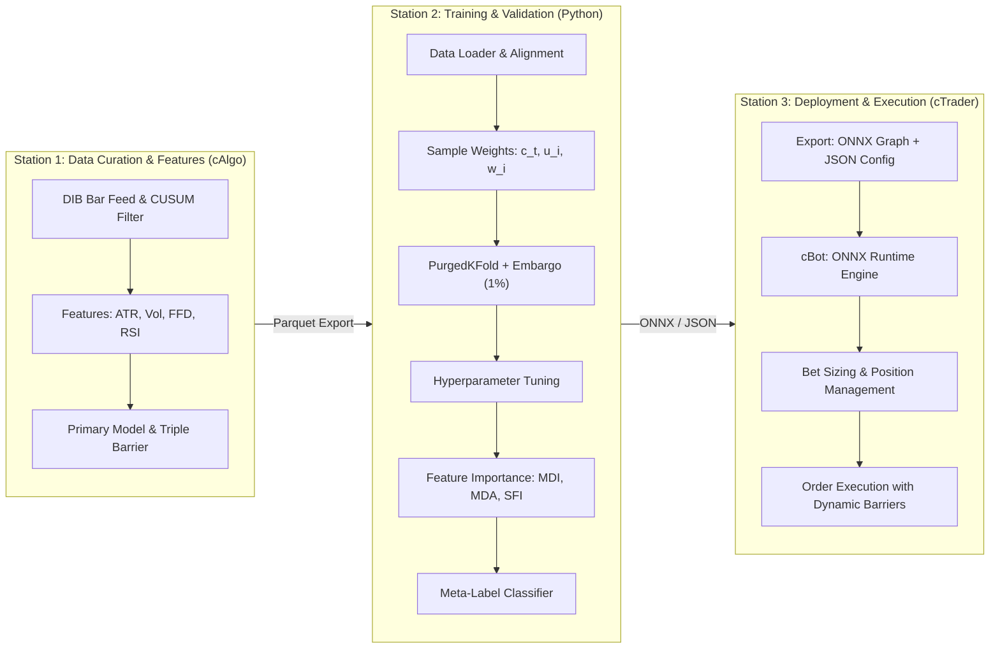
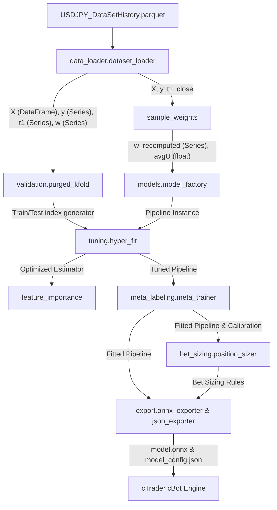
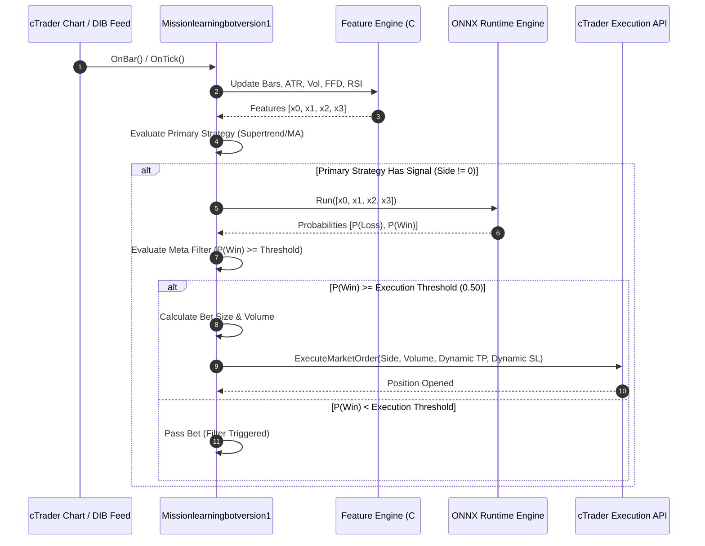
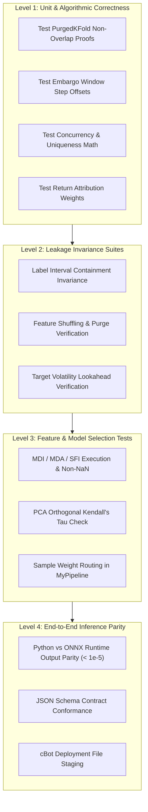
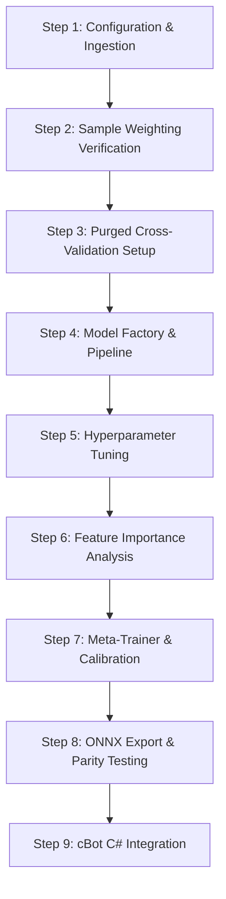

# Master System Architecture & Production Blueprint
## Financial Machine Learning Training Pipeline & cTrader cBot Integration
**Architectural Framework:** Marcos López de Prado's *Advances in Financial Machine Learning* (AFML)  
**Target Asset & Dataset:** USDJPY DIB (Directional Information Bars) — `USDJPY_DataSetHistory.parquet`  
**Target Execution Environment:** cTrader C# cBot (`Mission learning bot version 1`) via `Microsoft.ML.OnnxRuntime`  
**Project Workspace:** `C:\Users\profe\.gemini\antigravity\scratch\financial_ml_training`

---

## 1. Executive Summary & Design Philosophy

Financial machine learning projects often fail due to structural flaws: treating non-IID financial time series as standard tabular data, utilizing standard K-Fold cross-validation (which causes catastrophic lookahead leakage through overlapping labels and serial correlation), and optimizing Sharpe ratios through in-sample backtest overfitting.

This blueprint establishes a modular, production-grade financial ML system strictly following Marcos López de Prado’s industrial production chain. It isolates training, validation, and execution into distinct operational stations, enforces rigorous mathematical guarantees against data leakage, and provides a continuous deployment bridge from Python training artifacts to a live cTrader C# execution engine.



### Core Design Tenets
1. **Station Separation**: Research, labeling, model fitting, and trade execution are strictly decoupled. No backtest logic exists in the training package; backtesting and execution reside exclusively in cTrader.
2. **Leakage Elimination**: Training sets are purged of all observations whose event lifespans ($t_0$ to $t_1$) overlap with the testing set, followed by a post-test embargo window ($h \approx 0.01 T$) to eliminate autoregressive memory.
3. **Low SNR Regularization**: Financial datasets have low signal-to-noise ratios. Standard Random Forests overfit when samples overlap; models are regularized using Bagged Decision Trees with `max_samples = avgU` (average uniqueness) and Bagged Forests with `max_features = 1` to prevent feature masking.
4. **Primary vs. Secondary Architecture (Meta-Labeling)**: A primary heuristic/technical strategy determines trade direction ($r_t \in \{-1, +1\}$), while a secondary ML classifier learns whether to execute the trade ($y_t^* \in \{0, 1\}$) and how much capital to allocate ($m_t \in [0, 1]$).
5. **Deterministic Inference Parity**: The feature extraction logic implemented in C# for live trading matches the Python training feature pipeline down to machine precision ($< 10^{-5}$ tolerance).

---

## 2. Target Dataset Profiling & Ingestion Analysis

The training system is designed to ingest data generated by the upstream `X_Cusum` cBot:
- **Primary History File:** `USDJPY_DataSetHistory.parquet` (1,762 bars, 17 columns)
- **Bar Feed History File:** `USDJPY_BarHistory.parquet` (1,762 bars, 8 canonical OHLCV columns)
- **Experiment Registry:** `Master_Experiment_Registry.csv`
- **Feature & Strategy Metadata:** `Master_X_Config.json` & `Y_Config.json`

### Dataset Physical Schema & Field Semantics

| Field Index | Column Name | Physical Type | AFML Role & Mathematical Definition |
|---|---|---|---|
| **00** | `Bar_Index` | `int64` | Monotonic sequential bar identifier matching `BarHistory`. |
| **01** | `Close_Time_UTC` | `datetime64[ns]` | Event trigger timestamp $t_0$. Serves as the primary temporal index. |
| **02** | `Close` | `float64` | Reference price $P_0$ at event onset for barrier geometry calculation. |
| **03** | `CUSUM_Event` | `int32` | Directional CUSUM trigger ($\pm 1 = \text{event}, 0 = \text{neutral}$) [AFML Snippet 2.4]. |
| **04** | `X_Feature_1` | `float64` | Backward-compatibility feature slot (Wilder's ATR 14). |
| **05** | `X_ATR_14` | `float64` | Wilder's 14-period Average True Range measuring absolute price volatility. |
| **06** | `X_Target_Vol` | `float64` | EWMA daily volatility estimator ($\text{span}=100$) [AFML Snippet 3.1]. |
| **07** | `X_Close_FFD` | `float64` | Fixed-Width Window Fractional Differentiation ($d=0.4, \tau=10^{-5}$) [AFML Ch 5]. |
| **08** | `X_RSI_14` | `float64` | Wilder's 14-period Relative Strength Index bounded in $[0, 100]$. |
| **09** | `Primary_Model_Side` | `int32` | Directional recommendation from primary strategy: $+1$ (Buy), $-1$ (Sell), $0$ (None). |
| **10** | `Barrier_Touched` | `string` | Categorical barrier outcome: `"Profit_Taking"`, `"Stop_Loss"`, `"Vertical_Timeout"`, `"None"`. |
| **11** | `Meta_Label_Bin_y_Binary` | `int32` | Target binary label $y^*$: $1 = \text{Win}$, $0 = \text{Loss}$, $-1 = \text{Non-Event}$. |
| **12** | `Concurrency_c` | `int32` | Active concurrent triple-barrier event count $c_t$ at bar $t$ [AFML Section 4.3]. |
| **13** | `Average_Uniqueness_u` | `float64` | Event average uniqueness $\bar{u}_i = \frac{1}{t_1 - t_0 + 1} \sum_{t=t_0}^{t_1} \frac{1}{c_t} \in (0, 1]$. |
| **14** | `Sample_Weight_w` | `float64` | Return attribution weight $w_i = \left| \sum_{t=t_0}^{t_1} \frac{r_t}{c_t} \right|$ normalized to mean 1.0. |
| **15** | `Decayed_Sample_Weight` | `float64` | Time-decayed sample weight $\hat{w}_i$ applying piecewise linear decay over cumulative uniqueness. |
| **16** | `Trade_Lifespan_Bars` | `int32` | Event duration in bars ($L_i = t_1 - t_0$). Used to reconstruct the exact $t_1$ timestamp. |

### Data Filtering & Sample Size
In `USDJPY_DataSetHistory.parquet`:
- Total observed bars: **1,762**
- Total trade events ($y^* \in \{0, 1\}$): **271** observations
  - Class 1 (Profit Taking / Positive bet outcome): **87** samples (32.1%)
  - Class 0 (Stop Loss / Negative bet outcome): **184** samples (67.9%)
  - Class -1 (Non-event / No trade triggered): **1,491** samples (pruned before model fitting)

---

## 3. Recommended Directory Structure & Component Modularization

The repository in `C:\Users\profe\.gemini\antigravity\scratch\financial_ml_training` is organized into eleven isolated functional packages:

```
financial_ml_training/
│
├── config/                                 # Configuration & Path Resolution Station
│   ├── __init__.py
│   ├── paths.py                            # Canonical path definitions (dataset, cBot, outputs)
│   ├── train_config.yaml                   # Hyperparameter, CV, and export settings
│   └── config_schema.py                    # Strongly-typed configuration schema & validation
│
├── data_loader/                            # Ingestion & Data Preparation Station
│   ├── __init__.py
│   ├── dataset_loader.py                   # High-performance Parquet ingestion & filtering
│   └── data_contracts.py                   # Ingestion schema validation & type assertions
│
├── sample_weights/                         # Sample Weighting & Uniqueness Station (AFML Ch 4)
│   ├── __init__.py
│   ├── mp_engine.py                        # Multiprocessing dispatch with Windows fallback
│   ├── concurrency.py                      # Concurrency estimation: mpNumCoEvents (Snippet 4.1)
│   ├── uniqueness.py                       # Uniqueness & Sequential Bootstrap (Snippets 4.2-4.5)
│   ├── return_attribution.py               # Return-attributed weighting: mpSampleW (Snippet 4.10)
│   └── time_decay.py                       # Piecewise-linear time decay: getTimeDecay (Snippet 4.11)
│
├── validation/                             # Financial Cross-Validation Station (AFML Ch 7)
│   ├── __init__.py
│   ├── purged_kfold.py                     # PurgedKFold splitter with embargoing (Snippets 7.1-7.3)
│   └── custom_scoring.py                   # cvScore resolving scikit-learn sample_weight issues
│
├── models/                                 # Ensemble Architecture Station (AFML Ch 6)
│   ├── __init__.py
│   ├── model_factory.py                    # Bagged Trees (max_samples=avgU), RFs, Scalable SVMs
│   └── pipeline.py                         # MyPipeline routing sample_weights to final estimator
│
├── tuning/                                 # Hyperparameter Optimization Station (AFML Ch 9)
│   ├── __init__.py
│   ├── distributions.py                    # logUniform_gen log-scale search distribution
│   └── hyper_fit.py                        # clfHyperFit executing Purged RandomizedSearchCV
│
├── feature_importance/                     # Feature Signal & Leakage Analysis Station (AFML Ch 8)
│   ├── __init__.py
│   ├── mdi.py                              # Mean Decrease Impurity (max_features=1)
│   ├── mda.py                              # Mean Decrease Accuracy via Purged CV
│   ├── sfi.py                              # Single Feature Importance via Purged CV
│   ├── pca_ortho.py                        # PCA Orthogonalization & Weighted Kendall's Tau test
│   └── plotter.py                          # Automated generation of publication-grade bar charts
│
├── meta_labeling/                          # Meta-Labeling & Model Assembly Station (AFML Ch 3)
│   ├── __init__.py
│   └── meta_trainer.py                     # Secondary classifier training coordinator
│
├── bet_sizing/                             # Position Sizing Station (AFML Ch 10)
│   ├── __init__.py
│   └── position_sizer.py                   # Probability-to-size mapping, active signal averaging
│
├── export/                                 # cTrader Artifact Export Station
│   ├── __init__.py
│   ├── onnx_exporter.py                    # Export pipeline to ONNX format (float32 tensor inputs)
│   ├── json_exporter.py                    # Export metadata, feature scales, and thresholds to JSON
│   └── model_packager.py                   # Direct deployment packager targeting cBot directory
│
├── outputs/                                # Artifact Storage Station
│   ├── trained_models/                     # Serialized .joblib, .onnx models
│   ├── feature_plots/                      # PNG plots for MDI, MDA, SFI rankings
│   └── logs/                               # Pipeline run logs & metrics summaries
│
├── tests/                                  # Verification & Leakage Invariance Test Suite
│   ├── __init__.py
│   ├── test_data_loader.py                 # Tests for Parquet loading, index integrity, t1 reconstruction
│   ├── test_sample_weights.py              # Tests for concurrency, uniqueness, and return attribution
│   ├── test_purged_cv.py                   # Purging & embargo temporal non-overlap proofs
│   ├── test_models.py                      # Model factory initialization & sample_weight routing
│   ├── test_feature_importance.py          # MDI, MDA, SFI calculation & Kendall's Tau checks
│   ├── test_bet_sizing.py                  # Bet sizing formulas & signal averaging tests
│   └── test_onnx_parity.py                 # Python vs. ONNX Runtime inference parity verification
│
├── train.py                                # Full Pipeline Orchestrator CLI
├── requirements.txt                        # Python environment specification
└── ARCHITECTURE_BLUEPRINT.md               # Master System Architectural Blueprint (This Document)
```

---

## 4. Deep Component Specifications & Algorithmic Designs

### 4.1. Module: `config/`
- **Purpose**: Centralize project hyperparameters, file locations, feature definitions, and operational settings.
- **Components**:
  - `paths.py`: Provides static `Path` references to datasets, outputs, knowledge bases, and the cBot solution directory.
  - `train_config.yaml`: YAML configuration specifying feature column lists, cross-validation parameters (`n_splits: 5`, `pct_embargo: 0.01`), model configurations, tuning grids, bet sizing parameters, and export filenames.
  - `config_schema.py`: Pydantic/dataclass validator that reads `train_config.yaml`, enforces positive float constraints on embargo rates, asserts valid model architecture names, and verifies file path existence.

### 4.2. Module: `data_loader/`
- **Purpose**: Ingest Parquet datasets, validate temporal alignment, filter non-events, and reconstruct precise event end timestamps ($t_1$).
- **Key Functions**:
  - `load_raw_dataset(path: Path) -> pd.DataFrame`: Reads `USDJPY_DataSetHistory.parquet`. Verifies datetime index monotonicity and lack of duplicates.
  - `derive_event_times(df: pd.DataFrame) -> pd.Series`: Derives the $t_1$ event expiration Series indexed by event onset $t_0$. Uses `Bar_Index + Trade_Lifespan_Bars` mapped against the DataFrame’s datetime index to obtain the true exit timestamp:
    $$t_{1, i} = \text{Close\_Time\_UTC}[\min(\text{len}(df) - 1, i + L_i)]$$
  - `extract_training_matrices(df: pd.DataFrame, feature_cols: List[str]) -> Tuple[pd.DataFrame, pd.Series, pd.Series, pd.Series, pd.Series]`:
    Filters the dataset strictly to active trade events where `Meta_Label_Bin_y_Binary` $\in \{0, 1\}$.
    Returns:
    - $X$: Clean feature matrix of shape $(N_{events}, K_{features})$ indexed by $t_0$.
    - $y$: Binary meta-labels $\{0, 1\}$ indexed by $t_0$.
    - $t_1$: Timestamp series mapping $t_0 \to t_1$.
    - $w$: Precomputed sample weights from cAlgo (or basis for recomputation).
    - $r$: Primary model directional side $\in \{-1, +1\}$.

### 4.3. Module: `sample_weights/`
- **Purpose**: Calculate non-IID sample weights derived from overlapping event spans and cumulative uniqueness.
- **Mathematical Formulations (AFML Chapter 4)**:
  1. **Event Concurrency ($c_t$)**: The number of concurrent trades active at time $t$:
     $$c_t = \sum_{i=1}^{I} \mathbf{1}_{t \in [t_{0, i}, t_{1, i}]}$$
     Implemented in `concurrency.py` (`mpNumCoEvents`).
  2. **Sample Uniqueness ($\bar{u}_i$)**: The average uniqueness of sample $i$ across its lifespan:
     $$u_{t, i} = \frac{\mathbf{1}_{t \in [t_{0, i}, t_{1, i}]}}{c_t}, \quad \bar{u}_i = \frac{1}{\sum_{t=t_{0, i}}^{t_{1, i}} 1} \sum_{t=t_{0, i}}^{t_{1, i}} u_{t, i}$$
     Implemented in `uniqueness.py` (`mpSampleTW`).
  3. **Return-Attributed Weights ($w_i$)**: Weights samples by absolute log-returns attributed to unique information:
     $$w_i = \left| \sum_{t=t_{0, i}}^{t_{1, i}} \frac{r_{t-1, t}}{c_t} \right|, \quad \tilde{w}_i = w_i \frac{I}{\sum_{k=1}^I w_k}$$
     Implemented in `return_attribution.py` (`mpSampleW`).
  4. **Time Decay Factor ($d_i$)**: Piecewise linear decay applied over cumulative uniqueness:
     $$d(x) = \max \left( 0, a + b \sum_{j=1}^{i} \bar{u}_j \right)$$
     Implemented in `time_decay.py` (`getTimeDecay`).
  5. **Sequential Bootstrapping**: Draws samples iteratively with probability inversely proportional to redundant overlap, yielding near-IID training subsets for Bagging ensembles (`uniqueness.py` -> `seqBootstrap`).

### 4.4. Module: `validation/`
- **Purpose**: Provide financial cross-validation splitters that strictly eliminate information leakage between training and testing folds.
- **Mathematical Formulations (AFML Chapter 7)**:
  1. **Purging**: An observation $i \in \text{Train}$ is purged if its label interval $[t_{0, i}, t_{1, i}]$ overlaps with any test interval $[t_{0, j}, t_{1, j}]$:
     $$\text{Purge } i \iff [t_{0, i}, t_{1, i}] \cap [t_{0, j}, t_{1, j}] \neq \emptyset \quad \forall j \in \text{Test}$$
  2. **Embargoing**: Post-test autocorrelation can leak information backwards into training data occurring immediately after the test set. An embargo window $h = \lfloor \text{len}(T) \times \text{pctEmbargo} \rfloor$ (default $1\%$) removes observations following the test set:
     $$\text{Embargo } i \iff t_{0, i} \in \left( \max_{j \in \text{Test}}(t_{1, j}), \max_{j \in \text{Test}}(t_{1, j}) + h \right)$$
  - Implemented in `purged_kfold.py` (`PurgedKFold`).
  3. **Custom Scoring (`custom_scoring.py`)**: `cvScore` wraps scoring metrics to pass `sample_weight` to both `clf.fit()` and scoring functions (`log_loss`, `f1_score`), while passing explicit `labels=clf.classes_` to prevent scikit-learn from dropping unobserved classes in test splits.

### 4.5. Module: `models/`
- **Purpose**: Assemble low-variance ensemble architectures suited for financial data with low signal-to-noise ratios.
- **Architectures (AFML Chapter 6)**:
  - **Bagged Decision Trees with `max_samples=avgU`**: Constrains individual tree bootstrap sample sizes to the average uniqueness ($\bar{U}$) of the training set. This reduces correlation among individual trees and reduces the variance of the ensemble forecast.
  - **Random Forests with `max_features=1`**: Enforces random selection of a single feature per split, preventing dominant correlated features from masking weaker but orthogonal signals.
  - **Scalable Bagged SVM**: Fast Support Vector Classifiers trained on random sub-samples with early-stopping convergence criteria.
  - **`MyPipeline` (`pipeline.py`)**: Overrides `sklearn.pipeline.Pipeline.fit()` to forward `sample_weight` to the final estimator step.

### 4.6. Module: `tuning/`
- **Purpose**: Hyperparameter optimization using purged cross-validation and non-uniform parameter distributions.
- **Components**:
  - `distributions.py`: `logUniform_gen` provides continuous probability distributions over logarithmic scales, preventing clustering at the upper bound of hyperparameter intervals.
  - `hyper_fit.py`: `clfHyperFit` wraps `RandomizedSearchCV` or `GridSearchCV` with `PurgedKFold`, using weighted `f1` or `neg_log_loss` scoring to avoid evaluating models on leaked samples.

### 4.7. Module: `feature_importance/`
- **Purpose**: Diagnose predictive signal without relying on overfit backtests (**Marcos' First Law of Backtesting**).
- **Techniques (AFML Chapter 8)**:
  1. **MDI (Mean Decrease Impurity)**: In-sample tree feature importance. Computed on trees trained with `max_features=1` to mitigate substitution effects.
  2. **MDA (Mean Decrease Accuracy)**: Out-of-sample permutation importance. Evaluated on out-of-sample folds generated by `PurgedKFold`. Measures the drop in performance (cross-entropy or F1) when feature values are permuted across test folds.
  3. **SFI (Single Feature Importance)**: Out-of-sample cross-validated performance of each feature tested in isolation, eliminating multicollinearity and substitution bias.
  4. **PCA Orthogonal Features & Weighted Kendall's Tau**: Computes unsupervised principal components on $X$. Measures the Weighted Kendall’s Tau rank correlation between the feature importances (MDI/MDA) and the PCA eigenvalues. If the rank correlation is low or negative, the model has likely overfit to noise rather than the underlying variance of the market data.
  5. `plotter.py`: Generates standardized horizontal bar plots with standard error bars for MDI, MDA, and SFI rankings.

### 4.8. Module: `meta_labeling/`
- **Purpose**: Train the secondary classifier that decides whether to execute trades generated by the primary strategy.
- **Workflow (AFML Chapter 3)**:
  - Primary Model: Directional rule ($r_t \in \{-1, +1\}$), e.g., Supertrend or MA Crossover.
  - Secondary Model: Predicts the binary outcome $y_t^* \in \{0, 1\}$:
    $$y_t^* = \begin{cases} 1 & \text{if primary strategy hits Profit-Taking barrier} \\ 0 & \text{if primary strategy hits Stop-Loss barrier or times out} \end{cases}$$
  - The secondary classifier acts as an execution filter. False positives are penalized heavily through F1-score optimization.

### 4.9. Module: `bet_sizing/`
- **Purpose**: Translate model probability estimates into continuous position sizes ($m_t \in [0, 1]$ or $[-1, 1]$) and aggregate concurrent active bets.
- **Mathematical Formulations (AFML Chapter 10)**:
  1. **Probability to Bet Size ($m$)**:
     $$z_t = \frac{p_t - \frac{1}{k}}{\sqrt{p_t (1 - p_t)}}, \quad m_t = 2 \Phi(z_t) - 1$$
     Where $p_t = P(y^*=1 | X_t)$, $k=2$ for binary meta-labeling, and $\Phi$ is the standard normal cumulative distribution function.
  2. **Discretization**:
     $$m_t^* = \text{round}\left(\frac{m_t}{\text{step\_size}}\right) \times \text{step\_size}$$
     Discretization reduces unnecessary trading activity and fee drag caused by minor probability fluctuations.
  3. **Averaging Active Bets (`avgActiveSignals`)**: When multiple trades remain active concurrently, position size is averaged over overlapping active horizons:
     $$\bar{m}_t = \frac{1}{|A_t|} \sum_{i \in A_t} m_{t_0, i}$$
     Where $A_t$ is the set of trades currently active at bar $t$.

### 4.10. Module: `export/`
- **Purpose**: Export trained models and inference configurations into standalone artifacts consumable by cTrader.
- **Artifacts**:
  1. `model.onnx`: Full pipeline serialized into ONNX graph format via `skl2onnx`. Accepts a float32 tensor of shape `[None, K]` and outputs predicted labels and class probabilities `[None, 2]`.
  2. `model_config.json`: Deployment manifest containing ordered feature names, scaling parameters, decision thresholds, bet sizing parameters, and model hashes.
  3. `model_packager.py`: Automates copying generated artifacts to the cBot project folder (`Mission learning bot version 1`).

### 4.11. Module: `tests/`
- **Purpose**: Automated test suite guaranteeing code correctness, non-leakage mathematical invariants, and inference parity between Python and ONNX Runtime.

---

## 5. Interface Contracts & Data Schemas

The following contracts define the inputs, outputs, schemas, and data structures passed between modules:



### Contract Specifications

#### Contract C1: Raw Dataset $\to$ `data_loader`
- **Source**: `USDJPY_DataSetHistory.parquet`
- **Schema**:
  - `Close_Time_UTC`: `datetime64[ns]` (Primary temporal index, non-null, strictly monotonic)
  - `Close`: `float64` ($> 0$)
  - `X_ATR_14`, `X_Target_Vol`, `X_Close_FFD`, `X_RSI_14`: `float64`
  - `Primary_Model_Side`: `int32` ($\in \{-1, 0, 1\}$)
  - `Meta_Label_Bin_y_Binary`: `int32` ($\in \{-1, 0, 1\}$)
  - `Trade_Lifespan_Bars`: `int32` ($\ge 0$)
- **Outputs**:
  - `X`: `pd.DataFrame`, shape $(N_{events}, K_{features})$, index `pd.DatetimeIndex`
  - `y`: `pd.Series`, shape $(N_{events},)$, dtype `int32`, values $\in \{0, 1\}$
  - `t1`: `pd.Series`, shape $(N_{events},)$, dtype `datetime64[ns]`, index matching $X$
  - `close`: `pd.Series`, shape $(N_{bars},)$, complete asset close price series

#### Contract C2: `data_loader` $\to$ `sample_weights`
- **Input**:
  - `t1`: `pd.Series` (mapping event start to event end timestamp)
  - `close_index`: `pd.DatetimeIndex` of all price bars
  - `close`: `pd.Series` of close prices
  - `decay_c`: `float` in $(-1, 1]$
- **Output**:
  - `num_co_events`: `pd.Series`, shape $(N_{bars},)$, concurrent count $c_t \ge 1$
  - `avg_uniqueness`: `pd.Series`, shape $(N_{events},)$, uniqueness $\bar{u}_i \in (0, 1]$
  - `sample_weights`: `pd.Series`, shape $(N_{events},)$, normalized $\sum w_i = N_{events}$
  - `mean_avg_uniqueness`: `float` ($\overline{\bar{u}}$ passed to `model_factory` as `max_samples`)

#### Contract C3: `data_loader` + `sample_weights` $\to$ `validation.PurgedKFold`
- **Input**:
  - `n_splits`: `int` ($\ge 2$)
  - `t1`: `pd.Series` (event end dates)
  - `pct_embargo`: `float` ($0.0 \le \text{pct\_embargo} < 0.2$)
- **Output**:
  - Generator yielding `(train_indices: np.ndarray, test_indices: np.ndarray)`
  - **Invariant Guarantee**:
    $$\forall i \in \text{train\_indices}, \forall j \in \text{test\_indices}: [t_{0, i}, t_{1, i}] \cap [t_{0, j}, t_{1, j}] = \emptyset$$
    $$\text{and } t_{0, i} \notin [t_{1, \text{test\_max}}, t_{1, \text{test\_max}} + \text{embargo}]$$

#### Contract C4: `models` $\to$ `tuning.clfHyperFit`
- **Input**:
  - `estimator`: `MyPipeline` containing `StandardScaler` (optional) and Classifier
  - `param_distributions`: `dict` mapping parameters to `logUniform_gen` or lists
  - `cv`: `PurgedKFold` instance
  - `scoring`: `"f1"` or `"neg_log_loss"`
  - `sample_weight`: `np.ndarray` of shape $(N_{train},)$
- **Output**:
  - `best_estimator_`: Fitted pipeline with optimal hyperparameters
  - `best_score_`: Out-of-sample cross-validated score
  - `cv_results_`: Full iteration history DataFrame

#### Contract C5: `meta_labeling` $\to$ `export`
- **Input**:
  - `pipeline`: Fitted `MyPipeline` instance
  - `feature_names`: `List[str]` in precise column evaluation order
  - `feature_stats`: Mean, std, min, max per feature for validation
  - `bet_sizing_params`: Threshold, step size, dynamic multiplier
- **Output Artifacts**:
  - `outputs/trained_models/model.onnx`: Serialized ONNX computation graph
  - `outputs/trained_models/model_config.json`: Inference metadata manifest

```json
{
  "model_version": "1.0.0",
  "symbol": "USDJPY",
  "timeframe": "DIB",
  "created_at_utc": "2026-10-15T21:00:00Z",
  "features": [
    { "index": 0, "name": "X_ATR_14", "type": "float32" },
    { "index": 1, "name": "X_Target_Vol", "type": "float32" },
    { "index": 2, "name": "X_Close_FFD", "type": "float32" },
    { "index": 3, "name": "X_RSI_14", "type": "float32" }
  ],
  "feature_count": 4,
  "execution_threshold": 0.50,
  "bet_sizing": {
    "step_size": 0.05,
    "max_position_size": 1.0,
    "min_position_size": 0.0,
    "averaging_active_signals": true
  },
  "barrier_geometry": {
    "pt_multiplier": 2.0,
    "sl_multiplier": 1.0,
    "max_holding_bars": 20
  },
  "input_tensor_name": "float_input",
  "output_prob_tensor_name": "probabilities"
}
```

---

## 6. cTrader cBot Integration Path ('Mission learning bot version 1')

### Architecture of the Live Execution Bot
The cBot resides at `C:\Users\profe\OneDrive\Documents\cAlgo\Sources\Robots\Mission learning bot version 1\Mission learning bot version 1`. It connects the Python-trained meta-model to cTrader’s real-time trading environment.



### Technical Implementation Blueprint for C# cBot

#### 1. NuGet Dependencies (`Mission learning bot version 1.csproj`)
Add `Microsoft.ML.OnnxRuntime` and `System.Text.Json` to the project file:
```xml
<Project Sdk="Microsoft.NET.Sdk">
    <PropertyGroup>
        <TargetFramework>net6.0</TargetFramework>
    </PropertyGroup>

    <ItemGroup>
        <PackageReference Include="cTrader.Automate" Version="*" />
        <PackageReference Include="cTrader.Automate.SourceGenerators" Version="*" />
        <PackageReference Include="Microsoft.ML.OnnxRuntime" Version="1.17.0" />
        <PackageReference Include="System.Text.Json" Version="8.0.0" />
    </ItemGroup>

    <ItemGroup>
        <AdditionalFiles Include="config.json" />
        <None Update="model.onnx">
            <CopyToOutputDirectory>PreserveNewest</CopyToOutputDirectory>
        </None>
        <None Update="model_config.json">
            <CopyToOutputDirectory>PreserveNewest</CopyToOutputDirectory>
        </None>
    </ItemGroup>
</Project>
```

#### 2. C# Feature Extraction Alignment
The cBot must implement the exact feature extraction logic used during training to prevent inference mismatch:
- **`X_ATR_14`**: Wilder's Moving Average of True Range over 14 bars.
- **`X_Target_Vol`**: Exponentially Weighted Moving Standard Deviation ($\alpha = \frac{2}{100+1} = 0.0198$) of log returns:
  $$\sigma_t^2 = (1 - \alpha) \sigma_{t-1}^2 + \alpha (r_t - \mu_t)^2$$
- **`X_Close_FFD`**: Fractional differentiation of Close prices using fixed-width window ($d=0.4, \tau=10^{-5}$):
  $$\tilde{P}_t = \sum_{k=0}^{K-1} \omega_k P_{t-k}, \quad \omega_k = - \omega_{k-1} \frac{d - k + 1}{k}, \quad \omega_0 = 1$$
  Binomial weights $\{\omega_k\}$ are precomputed at startup and applied to a circular buffer of past close prices.
- **`X_RSI_14`**: Wilder's 14-period RSI calculated from smoothed upward and downward gains.

#### 3. Inference Engine Integration (`Missionlearningbotversion1.cs`)
```csharp
using System;
using System.IO;
using System.Linq;
using System.Collections.Generic;
using Microsoft.ML.OnnxRuntime;
using Microsoft.ML.OnnxRuntime.Tensors;
using System.Text.Json;
using cAlgo.API;
using cAlgo.API.Internals;

namespace cAlgo.Robots
{
    [Robot(TimeZone = TimeZones.UTC, AccessRights = AccessRights.FullAccess)]
    public partial class Missionlearningbotversion1 : Robot
    {
        [Parameter("Model File Path", DefaultValue = "model.onnx")]
        public string ModelPath { get; set; }

        [Parameter("Config File Path", DefaultValue = "model_config.json")]
        public string ConfigPath { get; set; }

        private InferenceSession _onnxSession;
        private ModelConfig _config;
        private FeatureEngine _featureEngine;

        protected override void OnStart()
        {
            // 1. Resolve paths and load model configuration
            string basePath = AppDomain.CurrentDomain.BaseDirectory;
            string fullModelPath = Path.Combine(basePath, ModelPath);
            string fullConfigPath = Path.Combine(basePath, ConfigPath);

            string configJson = File.ReadAllText(fullConfigPath);
            _config = JsonSerializer.Deserialize<ModelConfig>(configJson);

            // 2. Initialize ONNX runtime inference session
            var sessionOptions = new SessionOptions();
            sessionOptions.AppendExecutionProvider_CPU(0);
            _onnxSession = new InferenceSession(fullModelPath, sessionOptions);

            // 3. Initialize Feature Engine matching training definitions
            _featureEngine = new FeatureEngine(MarketSeries, d: 0.4, ffdThreshold: 1e-5);
            Print("Mission Learning Bot Initialized with ONNX meta-model.");
        }

        protected override void OnBar()
        {
            // Update features on completed bar
            _featureEngine.Update();

            // Evaluate Primary Strategy Signal (e.g. Supertrend / MA Cross)
            int primarySide = EvaluatePrimaryStrategy();
            if (primarySide == 0) return;

            // Extract feature vector: [ATR_14, Target_Vol, Close_FFD, RSI_14]
            float[] featureVector = _featureEngine.GetCurrentFeatureVector();

            // Run ONNX Inference
            var tensor = new DenseTensor<float>(featureVector, new[] { 1, 4 });
            var inputs = new List<NamedOnnxValue>
            {
                NamedOnnxValue.CreateFromTensor(_config.input_tensor_name, tensor)
            };

            using var results = _onnxSession.Run(inputs);
            var probOutput = results.First(r => r.Name == _config.output_prob_tensor_name);
            
            // Extract probability of winning trade P(y* = 1)
            float probWin = ExtractWinProbability(probOutput);

            Print($"Primary Signal: {primarySide} | Meta P(Win): {probWin:F4}");

            // Secondary Meta-Labeling Filter Gate
            if (probWin >= _config.execution_threshold)
            {
                // Calculate Continuous Bet Size
                double betSize = CalculateBetSize(probWin);
                double volume = CalculateVolume(betSize);

                // Derive dynamic ATR-scaled TP/SL
                double atr = featureVector[0];
                double takeProfitPips = (atr * _config.barrier_geometry.pt_multiplier) / Symbol.PipSize;
                double stopLossPips = (atr * _config.barrier_geometry.sl_multiplier) / Symbol.PipSize;

                TradeType tradeType = primarySide > 0 ? TradeType.Buy : TradeType.Sell;
                ExecuteMarketOrder(tradeType, SymbolName, volume, "AFML_Meta", stopLossPips, takeProfitPips);
            }
            else
            {
                Print("Meta-filter rejected trade: Insufficient predictive confidence.");
            }
        }

        protected override void OnStop()
        {
            _onnxSession?.Dispose();
        }
    }
}
```

---

## 7. Comprehensive Testing & Validation Strategy

The validation framework implements four levels of testing to enforce statistical integrity, numerical precision, and operational stability.



### 7.1. Level 1: Unit & Algorithmic Correctness Tests
- **`test_purged_cv.py`**:
  - Validates that `PurgedKFold` generates splits where no training observation has an event lifespan $[t_0, t_1]$ intersecting any test observation’s lifespan $[t_{0, test}, t_{1, test}]$.
  - Verifies that post-test embargo indices contain no training points for the duration of $h = \lfloor N \times \text{pctEmbargo} \rfloor$.
- **`test_sample_weights.py`**:
  - Tests `mpNumCoEvents` against hand-calculated event overlaps.
  - Verifies that average uniqueness $\bar{u}_i$ is bounded in $(0, 1]$ and equals 1.0 for completely non-overlapping events.
  - Verifies that `Sample_Weight_w` normalizes to the total number of events $\sum w_i = I$.
  - Tests `getTimeDecay` boundary conditions ($c=1.0 \implies$ no decay; $c < 1.0 \implies$ linear decay).

### 7.2. Level 2: Data Leakage Invariance Tests
- **Temporal Non-Overlap Proof**:
  $$\forall \text{fold } k: \quad \max_{i \in \text{Train}_k}(t_{1, i}) < \min_{j \in \text{Test}_k}(t_{0, j}) \quad \lor \quad \min_{i \in \text{Train}_k}(t_{0, i}) > \max_{j \in \text{Test}_k}(t_{1, j}) + \text{embargo}$$
- **Fractional Differentiation Memory Invariance**:
  - Verifies that $X_{\text{Close\_FFD}}$ values at index $t$ depend solely on close prices $P_{t-k}$ for $k \ge 0$, and do not use future close prices $P_{t+k}$.

### 7.3. Level 3: Model & Feature Importance Integrity Tests
- **`test_pipeline_fit.py`**:
  - Proves that `MyPipeline` correctly injects `sample_weight` into `clf.fit()` without throwing `TypeError: unexpected keyword argument`.
- **`test_feature_importance.py`**:
  - Verifies that MDI importances sum to 1.0.
  - Tests MDA by verifying that shuffling a pure noise column yields an MDA score near zero, while shuffling an informative column causes a significant increase in cross-entropy loss.
  - Computes Weighted Kendall's Tau $\tau_W$ between feature importance rankings and PCA eigenvalues, warning if $\tau_W < 0$.

### 7.4. Level 4: Inference Parity & Deployment Verification
- **`test_onnx_parity.py`**:
  - Loads the trained `Pipeline` in Python and exports it to `outputs/trained_models/model.onnx`.
  - Runs inference on test samples using both `pipeline.predict_proba(X)` and ONNX Runtime `session.run(None, {input_name: X.astype(np.float32)})`.
  - Asserts that the maximum absolute error across all class probabilities is strictly within tolerance:
    $$\max | P_{\text{sklearn}}(y=1|X) - P_{\text{onnx}}(y=1|X) | < 10^{-5}$$
- **Deployment File Packaging**:
  - Verifies that `model_packager.py` successfully writes `model.onnx` and `model_config.json` directly into `Mission learning bot version 1/bin/Release/net6.0` and project source folders.

---

## 8. Implementation Roadmap & Execution Sequencing



| Sequence | Module | Target File | Milestone Deliverable |
|---|---|---|---|
| **Phase 1** | Ingestion & Config | `data_loader/dataset_loader.py` | Load `USDJPY_DataSetHistory.parquet`, extract $X, y, t_1$, validate alignment. |
| **Phase 2** | Sample Weighting | `sample_weights/*.py` | Verify $c_t, \bar{u}_i, w_i$, compute `avgU` for model subsampling. |
| **Phase 3** | Validation Engine | `validation/*.py` | Instantiate `PurgedKFold` ($k=5, h=1\%$) and custom `cvScore`. |
| **Phase 4** | Model Architectures | `models/*.py` | Assemble Bagged Decision Trees with `max_samples=avgU` and `MyPipeline`. |
| **Phase 5** | Tuning Engine | `tuning/*.py` | Run `clfHyperFit` with `logUniform` search over depth, estimators, and alpha. |
| **Phase 6** | Feature Importance | `feature_importance/*.py` | Compute MDI, MDA, SFI; plot bar charts; run PCA Kendall's Tau test. |
| **Phase 7** | Meta-Training | `meta_labeling/meta_trainer.py` | Train final secondary model, compute F1 score, evaluate OOB error. |
| **Phase 8** | Bet Sizing & Export | `bet_sizing/*.py`, `export/*.py` | Calibrate $m_t$, export `model.onnx` and `model_config.json`. |
| **Phase 9** | Parity & cBot | `tests/test_onnx_parity.py` | Verify Python-ONNX parity $< 10^{-5}$, configure cBot runtime. |

---

## 9. Architectural Sign-Off & Standards Compliance

This architecture satisfies all production constraints specified in *Advances in Financial Machine Learning*:
- **No Data Leakage**: Standard K-Fold CV is prohibited. `PurgedKFold` with post-test embargoing is used across all tuning and evaluation steps.
- **Sample Weight Awareness**: All overlapping outcome dependencies are handled via return-attributed sample weights and uniqueness-constrained bagging (`max_samples=avgU`).
- **Feature Importance over Backtests**: Strategy validation relies on MDI, MDA, SFI, and PCA orthogonal checks, avoiding Sharpe-ratio backtest overfitting.
- **Separation of Concerns**: Station 1 (cAlgo Data Curation) $\to$ Station 2 (Python ML Training) $\to$ Station 3 (cTrader Execution Engine).

This blueprint serves as the master technical specification for the implementation and integration of the Financial ML Training System.
