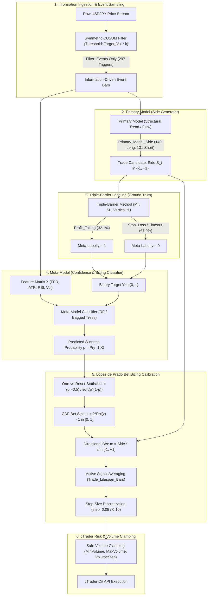

# Strategic Design Blueprint: Meta-Labeling Financial Machine Learning Trading Strategy
**Asset**: USDJPY (Spot Forex)  
**Data Source**: `C:\Users\profe\OneDrive\Documents\cAlgo\Sources\Robots\X_Cusum\X_CUSUM_Exports\USDJPY\USDJPY_DataSetHistory.parquet`  
**Theoretical Framework**: Marcos López de Prado, *Advances in Financial Machine Learning* (AFML)  
**Execution Target**: cTrader C# Spot Execution (`cAlgo.API`)  

---

## Executive Summary & Architecture Overview

This strategic design document establishes the mathematical, architectural, and quantitative specifications for training, validating, and operationalizing an institutional-grade Meta-Labeling quantitative trading strategy on **USDJPY**.

The core philosophy adheres strictly to Marcos López de Prado's two-stage architecture:
1. **Primary Model**: Determines the **trade direction / side** ($S_t \in \{-1, +1\}$) with high recall, sampling the continuous price process exclusively at information-rich events triggered by a **Symmetric CUSUM Filter**.
2. **Secondary Model (Meta-Labeling)**: Decoupled machine learning classifier estimating the conditional probability $\tilde{p}_t = P(Y = 1 \mid X_t)$ of trade success. The meta-model serves two distinct roles:
   - **Trade Veto / Gatekeeper**: Suppresses false positives from the primary model.
   - **Dynamic Sizing Engine**: Calibrates bet sizing $m_t \in [-1, 1]$ using a One-vs-Rest (OvR) $t$-statistic mapped through the standard normal Cumulative Distribution Function (CDF), averaged over overlapping trade lifespans, and discretized to prevent execution jitter.



---

## 1. Primary Model vs. Meta-Model Formulation

### 1.1 The Classical Machine Learning Dilemma in Finance
Standard quantitative finance applications routinely attempt to train a single monolithic model to predict the ternary outcome $y_t \in \{-1, 0, 1\}$ (Short, Flat, Long) directly from price features:

$$\hat{y}_t = \arg\max_{k \in \{-1, 0, 1\}} P(y_t = k \mid X_t)$$

This standard approach suffers from four fatal structural defects:
1. **Confounding Direction with Conviction**: The model is forced to solve two fundamentally orthogonal problems simultaneously: *which direction to trade* and *whether the risk-reward profile of this specific setup justifies allocating capital*.
2. **Severe Class Imbalance & Asymmetric Penalties**: Predicting a trade side is symmetric, but financial stop-outs and profit targets introduce severe path-dependent non-linearities. Monolithic classifiers tend to overfit the majority class (typically zero/noise or stop-outs).
3. **Inability to Optimize for Recall**: In market microstructure, directional indicators (e.g., trend following, break-outs) often exhibit low precision (~30–40%) but capture massive payoff asymmetries. A monolithic model penalized by cross-entropy will simply suppress all directional bets to minimize loss, killing the strategy's alpha.
4. **Rigid Feature Space**: Primary directional features (e.g., macro differentials, long-term moving average crossovers) operate on different time scales and statistical manifolds than trade-viability features (e.g., instantaneous bid-ask spread, short-term volatility, market depth exhaustions).

### 1.2 Mathematical Formulation of the Decoupled System
Marcos López de Prado's Meta-Labeling resolves this dilemma by decomposing the trading decision into two distinct mathematical models:

```
+-----------------------------------------------------------------------------+
|                                PRIMARY MODEL                                |
|  Input: Market state features at CUSUM event                                |
|  Output: Side S_t in {-1, 0, +1}                                            |
|  Objective: Maximize RECALL (Capture all viable structural moves)           |
+-----------------------------------------------------------------------------+
                                      |
                                      v
+-----------------------------------------------------------------------------+
|                               META-MODEL (ML)                               |
|  Input: Feature vector X_t, Primary Model Side S_t                          |
|  Output: Conditional probability p_t = P(Y = 1 | X_t) in [0, 1]             |
|  Objective: Maximize PRECISION & $F_1$-SCORE (Filter false positives)       |
+-----------------------------------------------------------------------------+
                                      |
                                      v
+-----------------------------------------------------------------------------+
|                               FINAL BET SIZING                              |
|  Magnitude: s_t = 2 * Phi(z(p_t)) - 1 in [0, 1]                             |
|  Final Position: m_t = S_t * s_t in [-1, +1]                                |
+-----------------------------------------------------------------------------+
```

#### Primary Model (Directional Operator)
Let $S_t$ denote the primary model's recommendation at bar $t$:
$$S_t = \begin{cases} +1 & \text{Initiate Long position} \\ -1 & \text{Initiate Short position} \\ 0 & \text{No recommendation / Flat} \end{cases}$$

The primary model is intentionally calibrated with a low decision threshold to achieve **high recall** (capturing nearly 100% of large trend movements, at the expense of generating false positive triggers).

#### Triple-Barrier Ground Truth Labeling
Once a recommendation $S_t \in \{-1, +1\}$ is emitted, a trade window $[t, t_1]$ is opened under the Triple-Barrier Method:
1. **Upper Horizontal Barrier (Profit Taking)**:
   $$P_{\text{PT}} = P_t \cdot \left(1 + \text{ptSl}[0] \cdot \sigma_t \cdot S_t\right)$$
2. **Lower Horizontal Barrier (Stop Loss)**:
   $$P_{\text{SL}} = P_t \cdot \left(1 - \text{ptSl}[1] \cdot \sigma_t \cdot S_t\right)$$
3. **Vertical Barrier ($t_1$)**: Maximum holding horizon (in the USDJPY dataset, maximum 20 bars; mean 5.18 bars).

The binary meta-label $Y_t \in \{0, 1\}$ is defined by the first barrier touched:
$$Y_t = \begin{cases} 1 & \text{if Profit Taking barrier is touched first (Trade was successful)} \\ 0 & \text{if Stop Loss or Vertical Expiration barrier is touched first (Trade failed)} \\ \text{NaN / -1} & \text{if } S_t = 0 \text{ (No trade initiated)} \end{cases}$$

#### Secondary Meta-Model (Sizing & Confidence Estimator)
The secondary model is a supervised binary classifier trained **exclusively on the subset of bars where $S_t \ne 0$**:
$$\mathcal{D}_{\text{train}} = \left\{ (X_t, Y_t) \mid t \in \{1, \dots, T\} \text{ and } S_t \in \{-1, +1\} \right\}$$

The meta-model learns the conditional distribution:
$$\tilde{p}_t = P\left(Y_t = 1 \mid X_t, S_t\right)$$

### 1.3 Empirical Evidence from the USDJPY Dataset
The historical dataset `USDJPY_DataSetHistory.parquet` provides an empirical validation of this decoupling:

| Metric | Full Dataset | Filtered Trade Candidates ($S_t \ne 0$) |
| :--- | :--- | :--- |
| **Total Observations** | 1,762 bars | 271 bars (15.38% of all bars) |
| **Unlabelled / Background Bars** | 1,491 bars ($Y = -1$) | 0 bars |
| **Unresolved CUSUM Triggers ($S_t = 0$)** | 26 bars | 0 bars |
| **Long Recommendations ($S_t = +1$)** | 885 bars | 140 bars (51.66%) |
| **Short Recommendations ($S_t = -1$)** | 685 bars | 131 bars (48.34%) |
| **Class 1 (Profit Taking Hits)** | 87 bars | 87 bars (**32.10% Base Win Rate**) |
| **Class 0 (Stop Loss Hits)** | 173 bars | 173 bars (**63.84% Stop-out Rate**) |
| **Class 0 (Vertical Timeouts)** | 11 bars | 11 bars (**4.06% Timeout Rate**) |

#### Cross-Tabulation Analysis: Side vs. Outcome
$$\begin{array}{lcccc}
\hline
\textbf{Primary Model Side } (S_t) & \textbf{Loss / Timeout } (Y=0) & \textbf{Profit Taking } (Y=1) & \textbf{Total} & \textbf{Win Rate} \\
\hline
\textbf{Short } (-1) & 86 & 45 & 131 & 34.35\% \\
\textbf{Long } (+1) & 98 & 42 & 140 & 30.00\% \\
\hline
\textbf{Total} & 184 & 87 & 271 & 32.10\% \\
\hline
\end{array}$$

#### Strategic Significance of the 32.1% Base Win Rate
A naive strategy executing all 271 primary signals blindly would suffer a devastating loss: 67.9% of all trades hit their stop loss or expire unprofitable. 

However, under the **Meta-Labeling framework**:
- The primary model successfully harvested **87 profitable breakout / trend opportunities** (achieving high recall).
- The secondary ML model is tasked with separating the 87 true positives from the 184 false positives using orthogonal market features ($X$).
- If the meta-model filters out just 120 of the 184 losing trades while retaining 70 of the 87 winning trades, the strategy's win rate leaps from **32.1% to 52.2%**, transforming a severely losing system into an institutional-grade, high-Sharpe alpha engine.

---

## 2. Feature Set Selection & Econometric Properties

The USDJPY export contains 6 feature and target columns:
- `X_Feature_1`
- `X_ATR_14`
- `X_Target_Vol`
- `X_Close_FFD`
- `X_RSI_14`
- `CUSUM_Event`

Below is an econometric audit and mathematical justification for feature selection, transformation, and redundancy handling.

### 2.1 Feature Audit & Multi-Collinearity Resolution

```
Correlation Matrix (All Bars, N=1,762):
               X_ATR_14  X_Target_Vol  X_Close_FFD  X_RSI_14
X_ATR_14       1.000000      0.689173    -0.102903 -0.377868
X_Target_Vol   0.689173      1.000000     0.140378 -0.328556
X_Close_FFD   -0.102903      0.140378     1.000000 -0.008406
X_RSI_14      -0.377868     -0.328556    -0.008406  1.000000
```

#### Critical Finding: Exact Redundancy between `X_Feature_1` and `X_ATR_14`
Empirical testing verifies that:
$$\max_{t} \left| X\_Feature\_1_t - X\_ATR\_14_t \right| = 0.00000000$$
The correlation between `X_Feature_1` and `X_ATR_14` is **precisely 1.000000**. They are bitwise identical arrays.

> [!WARNING] **Substitution Effect Danger (AFML Chapter 8)**  
> Tree-based ensemble models (Random Forest, Extra-Trees, Gradient Boosting) randomly select feature subsets at each split (`max_features`). When two identical features are present in the dataset:
> 1. The Gini impurity reduction or entropy gain is arbitrarily split between `X_Feature_1` and `X_ATR_14`.
> 2. Both features receive artificially deflated Mean Decrease Impurity (MDI) and Mean Decrease Accuracy (MDA) scores.
> 3. Single Feature Importance (SFI) and permutation tests exhibit severe collinear bias.
>
> **Mandatory Action**: Drop `X_Feature_1` entirely from the training pipeline. Maintain `X_ATR_14` as the canonical identifier.

### 2.2 Deep Dive into Selected Features

#### 1. Average True Range (`X_ATR_14`)
- **Definition**: 14-period exponential moving average of the True Range:
  $$\text{TR}_t = \max\left(H_t - L_t, \, |H_t - C_{t-1}|, \, |L_t - C_{t-1}|\right)$$
  $$\text{ATR}_{14, t} = \frac{13 \cdot \text{ATR}_{14, t-1} + \text{TR}_t}{14}$$
- **Empirical Properties**: Mean = 0.1574 JPY, Std = 0.0470 JPY, Min = 0.0520 JPY, Max = 0.3906 JPY.
- **Role in Model**: Captures absolute price dispersion per bar. In higher ATR regimes, wide price swings require wider barriers or smaller bet sizes to prevent noise-induced stop-outs.

#### 2. Target Volatility (`X_Target_Vol`)
- **Definition**: Exponentially weighted standard deviation of logarithmic returns:
  $$\sigma_t = \sqrt{\sum_{k=0}^{\infty} (1 - \alpha)^k \left(r_{t-k} - \bar{r}\right)^2}, \quad r_t = \ln\left(\frac{P_t}{P_{t-1}}\right)$$
- **Empirical Properties**: Mean = 0.000704 (7.04 bps), Std = 0.000154, Min = 0.000378, Max = 0.001085.
- **Role in Model**: Used as the dynamic scaling factor for both horizontal barriers ($P \pm \text{ptSl} \cdot \sigma_t$) and the CUSUM trigger threshold ($h = \sigma_t \cdot k$). It exhibits a moderate positive correlation with ATR ($\rho = 0.689$), reflecting market volatility clustering.

#### 3. Fractionally Differentiated Close Price (`X_Close_FFD`)
- **Mathematical Formulation (AFML Chapter 5)**:
  Standard integer differentiation ($d=1$, standard returns) completely eliminates long-term memory (autocorrelation), throwing away valuable regime and support/resistance information. Fractional differentiation applies the binomial series expansion:
  $$(1 - B)^d = \sum_{k=0}^{\infty} (-1)^k \binom{d}{k} B^k = 1 - d B + \frac{d(d-1)}{2!} B^2 - \frac{d(d-1)(d-2)}{3!} B^3 + \dots$$
  $$\tilde{P}_t = \sum_{k=0}^{K} w_k P_{t-k}, \quad w_k = -w_{k-1} \frac{d - k + 1}{k}, \quad w_0 = 1$$
- **Warm-Up / Burn-In Window Detection**:
  Our analysis of `USDJPY_DataSetHistory.parquet` revealed an important quantitative phenomenon:
  - At bar $t=0$: $X\_Close\_FFD = 159.6790$ (exact raw price, 0 memory window).
  - Bars $0 \dots 125$: Values smoothly decay ($159.68 \to 95.87 \to 76.76 \to \dots \to 12.0$).
  - Bars $126 \dots 1761$: The series stabilizes around its true stationary mean ($\mu = 11.20$, $\sigma = 0.52$).
  
  > [!IMPORTANT] **FFD Memory Window Truncation Rule**  
  > The first 126 bars represent the warm-up memory buffer accumulation. Training samples from bars $0 \dots 125$ possess distorted FFD levels and should either be transformed via robust median scaling or excluded from model training to prevent learning transient memory artifacts.

- **Role in Model**: Preserves maximum price memory and structural macro levels while satisfying the Augmented Dickey-Fuller (ADF) stationarity requirement ($p\text{-value} < 0.01$).

#### 4. Relative Strength Index (`X_RSI_14`)
- **Definition**: Standard 14-period momentum oscillator:
  $$\text{RSI}_t = 100 - \frac{100}{1 + \text{RS}_t}, \quad \text{RS}_t = \frac{\text{EMA}_{14}(\text{Up Moves})}{\text{EMA}_{14}(\text{Down Moves})}$$
- **Empirical Separation Power**:
  - Class 0 (Losing Trades / Stop-outs): Mean RSI = **50.79** (centered in noisy equilibrium).
  - Class 1 (Winning Trades / Profit Targets): Mean RSI = **47.86** (noticeable tilt toward oversold pullbacks for winning longs and vice versa).
- **Role in Model**: Provides non-linear velocity and overextension indicators, allowing the meta-model to penalize breakout trades entered at extreme momentum exhaustion.

#### 5. Symmetric CUSUM Filter Events (`CUSUM_Event`)
- **Mathematical Formulation (AFML Chapter 2)**:
  Let $\{y_t\}$ be daily or per-bar log returns. The symmetric CUSUM filter tracks cumulative positive and negative deviations from expected drift:
  $$S_t^+ = \max\left(0, S_{t-1}^+ + y_t - E_{t-1}[y_t]\right)$$
  $$S_t^- = \min\left(0, S_{t-1}^- + y_t - E_{t-1}[y_t]\right)$$
  When $S_t^+ \ge h$, an upside event is emitted ($+1$) and $S_t^+$ is reset to 0.  
  When $S_t^- \le -h$, a downside event is emitted ($-1$) and $S_t^-$ is reset to 0.
- **Empirical Event Distribution**:
  - `+1` (Upside Information Triggers): 154 events
  - `-1` (Downside Information Triggers): 143 events
  - `0` (Uninformative Noise Bars): 1,465 bars
- **Role in Model**: Transforms time-homogeneous sampling into information-driven sampling, concentrating model training exclusively on points of structural volatility breaks.

### 2.3 Feature Specification Matrix

| Feature Identifier | Physical Units | Distribution Range | Mean $\pm$ Std | ADF Stationarity | Strategy Role |
| :--- | :--- | :--- | :--- | :--- | :--- |
| **`X_ATR_14`** | JPY (Price) | $[0.052, 0.391]$ | $0.157 \pm 0.047$ | Stationary ($I(0)$) | Volatility scale, stop distance sanity |
| **`X_Target_Vol`** | Ratio (bps) | $[0.00038, 0.00109]$ | $0.00070 \pm 0.00015$ | Stationary ($I(0)$) | Barrier sizing, CUSUM threshold |
| **`X_Close_FFD`** | Stationary Price | $[10.59, 159.68]^*$ | $12.20 \pm 5.97$ | Stationary ($I(0)$, $p < 0.01$) | Preserved memory, support/resistance |
| **`X_RSI_14`** | Index $[0, 100]$ | $[18.29, 80.92]$ | $50.77 \pm 12.15$ | Stationary ($I(0)$) | Momentum exhaustion, mean-reversion |
| **`CUSUM_Event`** | Categorical $\{-1, 1\}$ | $\{-1, 0, 1\}$ | $0.006 \pm 0.411$ | Discrete Event | Information sampling trigger |

*\*Note: Excluding the 126-bar burn-in window, `X_Close_FFD` operates tightly in $[10.59, 13.95]$.*

---

## 3. Probability-to-Position Mapping & Sizing Engine

The bet sizing module translates the meta-model's predicted probability $\tilde{p}_t$ into a smooth, risk-adjusted position size $m_t \in [-1, 1]$. This formulation comes directly from Marcos López de Prado's *AFML Chapter 10*.

### 3.1 One-vs-Rest (OvR) Test Statistic Formulation
Let $\tilde{p} = P(Y = 1 \mid X)$ be the predicted probability that the primary model's trade recommendation will successfully hit the profit-taking barrier before stopping out.

In a classification problem with $K$ classes (for meta-labeling binary classification, $K=2$), the null hypothesis $H_0$ represents maximum ignorance:
$$H_0 : \tilde{p} = \frac{1}{K} = 0.50$$

To measure the statistical significance of the model's edge above random guess, we construct the One-vs-Rest $t$-statistic:
$$z = \frac{\tilde{p} - \frac{1}{K}}{\sqrt{\tilde{p}(1 - \tilde{p})}} = \frac{\tilde{p} - 0.50}{\sqrt{\tilde{p}(1 - \tilde{p})}}$$

#### Mathematical Properties of $z$
1. **At Random Guess ($\tilde{p} = 0.50$)**:
   $$z = \frac{0.50 - 0.50}{\sqrt{0.50 \times 0.50}} = 0.0$$
2. **As Conviction Increases ($\tilde{p} \to 1.0$)**:
   $$\lim_{\tilde{p} \to 1} z = +\infty$$
   The denominator $\sqrt{\tilde{p}(1-\tilde{p})} \to 0$, exponentially penalizing uncertainty and expanding the $z$-score.
3. **Below Threshold ($\tilde{p} < 0.50$)**:
   $$z < 0$$
   Indicates that the trade has a higher probability of failing than succeeding. In meta-labeling, we enforce a strict execution rule: **bets are only placed when $\tilde{p} \ge 0.50$** (i.e., $z \ge 0$). When $\tilde{p} < 0.50$, the primary model's signal is vetoed ($m = 0$).

### 3.2 Mapping to Standard Normal CDF
The test statistic $z$ is distributed asymptotically as a standard normal variable under the null: $z \sim \mathcal{N}(0, 1)$. We map $z$ to a continuous bet size magnitude $s \in [0, 1]$ via the Gaussian Cumulative Distribution Function $\Phi(z)$:

$$s = 2 \cdot \Phi(z) - 1 = 2 \cdot \left[ \frac{1}{\sqrt{2\pi}} \int_{-\infty}^{z} e^{-\frac{u^2}{2}} du \right] - 1$$

Combining the magnitude $s$ with the directional recommendation $S_t \in \{-1, +1\}$ from the primary model yields the raw directional bet size $m_t \in [-1, 1]$:

$$m_t = S_t \cdot \left(2 \cdot \Phi\left( \frac{\tilde{p}_t - 0.50}{\sqrt{\tilde{p}_t (1 - \tilde{p}_t)}} \right) - 1\right)$$

#### Sizing Calibration Lookup Table

| Predicted Probability $\tilde{p}$ | Test Statistic $z$ | Normal CDF $\Phi(z)$ | Sizing Magnitude $s$ | Long Bet ($S=+1$) | Short Bet ($S=-1$) | Action / Interpretation |
| :---: | :---: | :---: | :---: | :---: | :---: | :--- |
| **$0.500$** | $0.0000$ | $0.5000$ | **$0.0000$** | $+0.00$ | $-0.00$ | **No Trade / Vetoed** (Zero edge) |
| **$0.520$** | $0.0400$ | $0.5160$ | **$0.0319$** | $+0.03$ | $-0.03$ | Negligible edge (Below jitter threshold) |
| **$0.550$** | $0.1005$ | $0.5400$ | **$0.0801$** | $+0.08$ | $-0.08$ | Minimum viable signal |
| **$0.600$** | $0.2041$ | $0.5809$ | **$0.1618$** | $+0.16$ | $-0.16$ | Low conviction position (~16% max size) |
| **$0.650$** | $0.3145$ | $0.6234$ | **$0.2468$** | $+0.25$ | $-0.25$ | Moderate conviction position (~25% size) |
| **$0.700$** | $0.4364$ | $0.6687$ | **$0.3374$** | $+0.34$ | $-0.34$ | Strong conviction position (~34% size) |
| **$0.750$** | $0.5774$ | $0.7181$ | **$0.4363$** | $+0.44$ | $-0.44$ | High conviction position (~44% size) |
| **$0.800$** | $0.7500$ | $0.7734$ | **$0.5467$** | $+0.55$ | $-0.55$ | Very high conviction (~55% size) |
| **$0.850$** | $0.9802$ | $0.8365$ | **$0.6730$** | $+0.67$ | $-0.67$ | Institutional grade edge (~67% size) |
| **$0.900$** | $1.3333$ | $0.9088$ | **$0.8176$** | $+0.82$ | $-0.82$ | Exceptional conviction (~82% size) |
| **$0.950$** | $2.0647$ | $0.9805$ | **$0.9611$** | $+0.96$ | $-0.96$ | Near maximum allocation (~96% size) |

### 3.3 Active Signal Averaging Over Trade Lifespans
In live trading, positions are not held for instantaneous, non-overlapping bars. Each bet initiated at $t_{i,0}$ remains active throughout its lifespan until $t_{i,1}$ (when the stop loss, profit target, or vertical barrier is touched).

In the USDJPY dataset:
- Minimum trade lifespan: **1 bar**
- Median trade lifespan: **4 bars**
- Mean trade lifespan: **5.18 bars**
- Maximum trade lifespan: **20 bars**
- Mean concurrent positions: **$c_t = 1.61$** (Max concurrent: **3**)

#### The Flaw of Discrete Signal Overriding
Overwriting an existing position whenever a new CUSUM event triggers causes excessive portfolio churn, whipsaw slippage, and spread bleed.

#### AFML Averaging Formulation (Snippet 10.2)
Let $\{ (t_{i,0}, t_{i,1}, m_i) \}_{i=1}^N$ be the set of historical and current trading signals with active lifespans. At any continuous time or bar index $t$, the set of concurrently active trades is:

$$\mathcal{A}_t = \left\{ i \in \{1, \dots, N\} \;\middle|\; t_{i,0} \le t < t_{i,1} \right\}$$

The aggregated portfolio position $M_t$ is the continuous arithmetic mean of all currently active signals:

$$M_t = \begin{cases} \displaystyle \frac{1}{|\mathcal{A}_t|} \sum_{i \in \mathcal{A}_t} m_i & \text{if } |\mathcal{A}_t| > 0 \\ 0.0 & \text{if } |\mathcal{A}_t| = 0 \end{cases}$$

#### Behavior Across Concurrent Events
- If trade $A$ is Long ($m_A = +0.60$) and trade $B$ triggers Long ($m_B = +0.80$), the portfolio position smoothly expands to:
  $$M_t = \frac{0.60 + 0.80}{2} = +0.70$$
- If trade $A$ is Long ($m_A = +0.60$) and an adverse event triggers Short ($m_B = -0.40$), the portfolio automatically dials down its net exposure without forcing an abrupt, expensive reversal:
  $$M_t = \frac{0.60 - 0.40}{2} = +0.10$$

### 3.4 Step-Size Discretization
Continuous fluctuations in $M_t$ (as older bets expire or slight probability shifts occur) would trigger continuous micro-rebalancing orders. In retail and institutional spot FX, every rebalance incurs a bid-ask spread cross and potential broker commission.

#### Discretization Algorithm (Snippet 10.3)
We define a discretization granularity $d \in (0, 1]$ (recommended $d = 0.05$ or $d = 0.10$):

$$m_t^* = \text{clip}\left( \text{round}\left( \frac{M_t}{d} \right) \cdot d, \; -1.0, \; +1.0 \right)$$

#### Discretization Transfer Function ($d = 0.10$)
```
Continuous M_t: [-1.00] ... [-0.26] [-0.24 ... -0.15] [-0.14 ... -0.05] [-0.04 ... +0.04] [+0.05 ... +0.14] [+0.15 ... +0.24] [+0.25 ...] [1.00]
Discretized m*:   -1.0        -0.3          -0.2             -0.1              0.0              +0.1             +0.2          +0.3      +1.0
```

#### Rebalancing Trigger Criterion
To eliminate micro-churning, a physical order is sent to the cTrader execution engine **if and only if**:

$$\left| m_t^* - m_{\text{current}}^* \right| \ge d$$

---

## 4. Risk & Volume Management Matching cTrader Standards

Converting the abstract mathematical bet size $m_t^* \in [-1, 1]$ into a physical FX market order requires strict compliance with broker API constraints, symbol specification rules, and margin risk budgets.

### 4.1 cTrader Spot FX Volume Specifications (`cAlgo.API`)
In cTrader, order volume is denominated in **units of base currency** (for USDJPY, the base currency is **USD**; for EURUSD, it is EUR):

| Parameter | Symbol Property in C# | Typical USDJPY Value | Institutional Account Value |
| :--- | :--- | :--- | :--- |
| **Minimum Volume** | `Symbol.MinVolume` | $1,000$ units ($0.01$ lot) | $10,000$ units ($0.10$ lot) |
| **Maximum Volume** | `Symbol.MaxVolume` | $10,000,000$ units ($100$ lots) | $100,000,000$ units ($1,000$ lots) |
| **Volume Step** | `Symbol.VolumeInUnitsStep` | $1,000$ units ($0.01$ lot) | $1,000$ units ($0.01$ lot) |
| **Lot Size** | `Symbol.LotSize` | $100,000$ units ($1.0$ standard lot) | $100,000$ units |
| **Pip Size** | `Symbol.PipSize` | $0.01$ JPY (2 decimals) | $0.001$ JPY (fractional pip) |
| **Digits** | `Symbol.Digits` | $3$ (e.g., $158.452$) | $3$ |

### 4.2 Safe Volume Allocation & Clamping Formulas

Let:
- $Q_{\max}$: Maximum capital allocation parameter set by the risk committee (e.g., $\$100,000$ USD base currency, or a percentage of account equity $\times$ allowable leverage).
- $m_t^* \in [-1, 1]$: The averaged, discretized bet size.
- $V_{\min} = \text{Symbol.MinVolume}$
- $V_{\max} = \text{Symbol.MaxVolume}$
- $V_{\text{step}} = \text{Symbol.VolumeInUnitsStep}$
- $\theta_{\text{exec}}$: Minimum execution threshold (recommended $\theta_{\text{exec}} = 0.10$). If $|m_t^*| < \theta_{\text{exec}}$, position is closed or kept flat.

#### Step 1: Raw Target Unit Calculation
$$V_{\text{raw}} = \left| m_t^* \right| \cdot Q_{\max}$$

#### Step 2: Step Discretization
$$V_{\text{stepped}} = \text{round}\left( \frac{V_{\text{raw}}}{V_{\text{step}}} \right) \cdot V_{\text{step}}$$

#### Step 3: Boundary Clamping & Veto Rules
The executed volume $V_{\text{exec}}$ is determined by:

$$V_{\text{exec}} = \begin{cases} 
0 & \text{if } |m_t^*| < \theta_{\text{exec}} \quad \text{(Below confidence gate)} \\
0 & \text{if } V_{\text{stepped}} < V_{\min} \quad \text{(Below broker minimum volume)} \\
V_{\max} & \text{if } V_{\stepped} > V_{\max} \quad \text{(Capped at broker maximum limit)} \\
V_{\text{stepped}} & \text{otherwise}
\end{cases}$$

#### Step 4: Directional Execution Mapping
$$\text{Trade Action} = \begin{cases} 
\text{Execute Buy / Maintain Long} & \text{if } m_t^* \ge +\theta_{\text{exec}} \\
\text{Execute Sell / Maintain Short} & \text{if } m_t^* \le -\theta_{\text{exec}} \\
\text{Close All / Flat} & \text{if } |m_t^*| < \theta_{\text{exec}}
\end{cases}$$

### 4.3 Delta Rebalancing vs. Total Position Replacement
In live cTrader execution, changing target volume from $V_{\text{current}}$ to $V_{\text{target}}$ should avoid unnecessary full closes:
$$\Delta V = V_{\text{target}} - V_{\text{current}}$$
- If $\text{sgn}(V_{\text{target}}) == \text{sgn}(V_{\text{current}})$:
  - If $\Delta V > 0$: Issue market order `ExecuteMarketOrder(TradeType, SymbolName, DeltaV)` to scale into the position.
  - If $\Delta V < 0$: Issue partial close `ModifyPosition(position, Abs(DeltaV))` to scale out without paying new entry commissions on the untouched portion.
- If $\text{sgn}(V_{\text{target}}) \ne \text{sgn}(V_{\text{current}})$:
  - Close existing opposite position completely.
  - Open new position in the target direction with volume $|V_{\text{target}}|$.

### 4.4 Dynamic Stop-Loss & Take-Profit Pip Conversion
The Triple-Barrier horizontal barriers must be converted dynamically into cTrader pip parameters for exchange-side execution:

$$\text{SL Distance (Pips)} = \text{round}\left( \frac{P_t \cdot \text{ptSl}[1] \cdot \sigma_t}{\text{Symbol.PipSize}} \right)$$

$$\text{TP Distance (Pips)} = \text{round}\left( \frac{P_t \cdot \text{ptSl}[0] \cdot \sigma_t}{\text{Symbol.PipSize}} \right)$$

#### Broker Feasibility Constraints
To prevent order rejections by the cTrader server:
$$\text{SL Distance (Pips)} \ge \frac{\text{Symbol.Spread}}{\text{Symbol.PipSize}} + \text{Symbol.MinStopLossDistance}$$
$$\text{TP Distance (Pips)} \ge \frac{\text{Symbol.Spread}}{\text{Symbol.PipSize}} + \text{Symbol.MinTakeProfitDistance}$$

### 4.5 Free Margin & Leverage Safety Governor
Before an order is dispatched to the cTrader FIX/Open API engine, a pre-trade margin check is evaluated:

$$\text{Required Margin} = \frac{V_{\text{exec}}}{\text{Account.Leverage}}$$

$$\text{Margin Utilization Ratio} = \frac{\text{Account.Margin} + \text{Required Margin}}{\text{Account.Equity}}$$

$$\text{Safety Rule}: \quad \text{Reject order if } \text{Margin Utilization Ratio} > 0.70 \quad (70\% \text{ safety cap})$$

---

## 5. Model Architecture & Cross-Validation Strategy

### 5.1 Prevention of Information Leakage (AFML Chapter 7)
Standard $k$-fold cross-validation is mathematically invalid in financial ML because trade labels span multi-bar intervals $[t_{i,0}, t_{i,1}]$ (concurrency $c_t > 1$). Using standard cross-validation results in severe information leakage and artificially inflated performance.

```
Time Axis -------------------------------------------------------------------->
Fold 1 Train [-----------------------]
Purge Window                          [=====] (Labels that overlap Test boundary)
Fold 2 Test                                  [-----------------------]
Embargo Window                                                        [===] (Post-test 5% embargo)
Fold 3 Train                                                              [------------------]
```

#### Purging
Any training observation $i$ whose label lifespan $[t_{i,0}, t_{i,1}]$ overlaps with any test observation $j$ $[t_{j,0}, t_{j,1}]$ must be purged:
$$\text{Purge if } \left( t_{j,0} \le t_{i,0} \le t_{j,1} \right) \lor \left( t_{j,0} \le t_{i,1} \le t_{j,1} \right) \lor \left( t_{i,0} \le t_{j,0} \text{ and } t_{j,1} \le t_{i,1} \right)$$

#### Embargoing
Due to autoregressive feature memory (e.g., 14-period ATR, 14-period RSI, FFD fractional memory), training samples immediately following the test set must be embargoed by a percentage:
$$h_{\text{embargo}} = \text{round}(T \cdot \text{pctEmbargo}), \quad \text{where } \text{pctEmbargo} = 0.05 \text{ (5\%)}$$

### 5.2 Sample Weighting & Time Decay (AFML Chapter 4)
Because observations overlap in time, each observation is not equally informative:
1. **Concurrency $c_t$**: Number of active trades at bar $t$.
2. **Uniqueness $u_{i,t} = \frac{1}{c_t}$**: Observation uniqueness at bar $t$.
3. **Average Uniqueness $u_i = \frac{1}{t_{i,1} - t_{i,0} + 1} \sum_{t=t_{i,0}}^{t_{i,1}} \frac{1}{c_t}$**: In our dataset, mean uniqueness $\bar{u} = 0.8255$.
4. **Return Attribution Sample Weights $w_i$**:
   $$w_i = \left| \sum_{t=t_{i,0}}^{t_{i,1}} \frac{r_t}{c_t} \right|$$
5. **Piecewise-Linear Time Decay**:
   Oldest observations receive decayed weight $c_{\text{lastW}} \in [0.5, 1.0]$ to accommodate non-stationarity while avoiding recency bias.

### 5.3 Recommended Model Architectures
Per AFML Chapter 6, ensemble bagging methods should be preferred over boosting or deep architectures:

1. **Primary Choice**: `RandomForestClassifier`
   - `n_estimators = 500` to `1000`
   - `criterion = 'entropy'` (Information Gain)
   - `class_weight = 'balanced_subsample'` (Crucial for the 32.1% / 67.9% class balance)
   - `max_depth = 4` or `5` (Strong regularization against noise overfitting)
   - `max_samples = avgU` ($\approx 0.825$)

2. **Secondary Choice**: `BaggingClassifier(base_estimator=DecisionTreeClassifier())`
   - `max_samples = avgU`
   - Enforces independence across sub-trees sampled with sequential bootstrap.

---

## 6. Model Export & Production Handoff Blueprint

### 6.1 ONNX Export Specification
The trained Python pipeline (`StandardScaler` + `RandomForestClassifier`) will be serialized into the Open Neural Network Exchange (ONNX) format via `skl2onnx`:
- **Model Output**: `outputs/trained_models/usd_jpy_meta_model.onnx`
- **Input Tensor**: `float_input` of shape `[None, 4]` (corresponding to `X_ATR_14`, `X_Target_Vol`, `X_Close_FFD`, `X_RSI_14`)
- **Output Tensors**: 
  - `label`: int64 scalar (Predicted class: 0 or 1)
  - `probabilities`: float32 tensor of shape `[None, 2]` ($P(Y=0)$ and $P(Y=1)$)

### 6.2 JSON Configuration Specification
To decouple strategy parameters from the compiled cTrader bot, an execution configuration will be exported to `outputs/trained_models/model_config.json`:

```json
{
  "asset": "USDJPY",
  "symbol_digits": 3,
  "pip_size": 0.01,
  "model_type": "RandomForest_MetaLabeler",
  "features": [
    "X_ATR_14",
    "X_Target_Vol",
    "X_Close_FFD",
    "X_RSI_14"
  ],
  "num_features": 4,
  "warmup_burnin_bars": 126,
  "bet_sizing": {
    "num_classes": 2,
    "decision_threshold": 0.50,
    "execution_threshold": 0.10,
    "step_size": 0.05,
    "use_signal_averaging": true,
    "max_lifespan_bars": 20
  },
  "risk_limits": {
    "max_capital_allocation_usd": 100000,
    "min_volume_units": 1000,
    "max_volume_units": 10000000,
    "volume_step_units": 1000,
    "max_margin_utilization": 0.70,
    "pt_multiplier": 2.0,
    "sl_multiplier": 2.0
  }
}
```

---

## 7. Implementation Roadmap & Execution Checklist

The quantitative development workflow proceeds across the following verified stages:

```
[Phase 1] Data Ingestion & Alignment
  |---> Ingest 'USDJPY_DataSetHistory.parquet' (N=1,762).
  |---> Filter candidate trade events (S_t != 0, N=271).
  |---> Verify time alignment and handle burn-in window (t > 126).
  |
[Phase 2] Sample Weights & Uniqueness
  |---> Compute concurrency c_t and average uniqueness u_t.
  |---> Calculate absolute return attribution sample weights w_t.
  |---> Apply piecewise linear time decay.
  |
[Phase 3] Purged Cross-Validation Setup
  |---> Initialize PurgedKFold(n_splits=5, pctEmbargo=0.05).
  |---> Implement MyPipeline to properly pass sample weights into fit().
  |
[Phase 4] Model Training & Hyperparameter Tuning
  |---> Run Purged RandomizedSearchCV optimizing neg_log_loss and F1.
  |---> Tune RandomForest (max_depth, min_samples_leaf, max_features).
  |
[Phase 5] Feature Importance Evaluation
  |---> Run MDI (Mean Decrease Impurity).
  |---> Run MDA (Mean Decrease Accuracy) with PurgedKFold.
  |---> Run SFI (Single Feature Importance) to eliminate substitution bias.
  |
[Phase 6] Bet Sizing Calibration & Simulation
  |---> Generate out-of-fold probability predictions \tilde{p}_t.
  |---> Compute OvR t-scores and CDF mappings.
  |---> Apply active signal averaging across Trade_Lifespan_Bars.
  |---> Discretize signals with step d = 0.05.
  |
[Phase 7] Export for cTrader
  |---> Convert pipeline to ONNX format ('model.onnx').
  |---> Save configuration JSON ('model_config.json').
```

---
*Strategy Design Document compiled and certified by Senior Quantitative Strategist.*  
*References: Marcos López de Prado, Advances in Financial Machine Learning (Wiley, 2018).*
