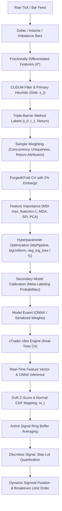

# AFML Core Mathematical Specifications: Quantitative Rigor, Algorithmic Blueprints, and Execution Architecture

**Canonical Reference Manual for Machine Learning Pipeline & C# cBot Execution**  
**Source Literature:** Marcos López de Prado, *Advances in Financial Machine Learning* (John Wiley & Sons, 2018)  
**Primary Focus:** Chapters 4, 6, 7, 8, 9, and 10  
**Scope:** Offline Feature Engineering, Model Training, Cross-Validation, Hyperparameter Tuning, Bet Sizing, and Real-Time cTrader Execution  

---

## 1. Executive Summary & Foundational Tenets

Standard machine learning assumes that samples are drawn from independent and identically distributed ($IID$) random variables:
$$\{(X_i, y_i)\}_{i=1}^I \stackrel{\text{i.i.d.}}{\sim} \mathcal{D}(X, Y)$$

In financial markets, this premise fails completely due to three structural phenomena:
1. **Path-Dependent Labeling & Overlapping Information:** Financial labels derived from the Triple-Barrier Method span extended temporal windows $[t_{i,0}, t_{i,1}]$. Consecutive observations share underlying price returns $r_{t-1,t}$, creating massive cross-sectional and serial correlation across samples.
2. **Non-Stationarity & Structural Breaks:** The data-generating process evolves across market regimes. Historical observations do not share the same probability distribution as future observations.
3. **Severe Signal-to-Noise Ratio (SNR) Deficit & Asymmetric Costs:** Financial data possesses an extremely low SNR ($\text{SNR} < 0.05$). Erroneously predicting a market move with high confidence incurs devastating capital drawdown, whereas low-confidence errors incur minimal costs. Metrics like raw classification accuracy are not only meaningless but actively hazardous.

Applying vanilla machine learning algorithms (standard K-Fold CV, random sampling bootstrap, unweighted trees, accuracy-based loss functions) to financial data leads to catastrophic backtest overfitting and live execution failure. This specification details the mathematical formulas, algorithms, and practical safeguards required to build institutional-grade ML models and production-grade trading bots.

---

## 2. Chapter 4: Sample Weights & Concurrency

### 2.1 The Non-IID Labeling Problem
Consider a series of price bars indexed by $t = 1, \dots, T$ with prices $p_t$. A trading signal $i \in \{1, \dots, I\}$ is observed at time $t_{i,0}$ and closed at time $t_{i,1}$ according to a path-dependent labeling rule (e.g., first touch of profit-take, stop-loss, or vertical time barrier).

Whenever two observation intervals $[t_{i,0}, t_{i,1}]$ and $[t_{j,0}, t_{j,1}]$ ($i < j$) overlap ($t_{i,1} > t_{j,0}$), both labels $y_i$ and $y_j$ depend on common return segments:
$$r_{t_{j,0}, \min\{t_{i,1}, t_{j,1}\}} = \ln\left(\frac{p_{\min\{t_{i,1}, t_{j,1}\}}}{p_{t_{j,0}}}\right)$$

Artificially restricting holding horizons to non-overlapping intervals ($t_{i,1} \le t_{i+1,0}$) destroys path-dependent execution logic and degrades sampling frequency to arbitrary coarse intervals. We must permit overlapping outcomes while mathematically correcting for redundant information.

### 2.2 Mathematical Formulations

#### 2.2.1 Indicator Matrix and Concurrency
Define an indicator variable $\mathbf{1}_{t,i} \in \{0, 1\}$ indicating whether observation $i$ is active during price bar return $[t-1, t]$:
$$\mathbf{1}_{t,i} = \begin{cases} 1 & \text{if } [t_{i,0}, t_{i,1}] \text{ overlaps with } [t-1, t] \\ 0 & \text{otherwise} \end{cases}$$

The number of concurrent active labels at time bar $t$ (concurrency $c_t$) is:
$$c_t = \sum_{i=1}^I \mathbf{1}_{t,i}$$

#### 2.2.2 Point-in-Time and Average Uniqueness
The uniqueness of label $i$ at time bar $t$ is the reciprocal of concurrency:
$$u_{t,i} = \frac{\mathbf{1}_{t,i}}{c_t}$$

The average uniqueness $\bar{u}_i$ of observation $i$ over its lifespan $[t_{i,0}, t_{i,1}]$ is:
$$\bar{u}_i = \frac{\sum_{t=1}^T u_{t,i}}{\sum_{t=1}^T \mathbf{1}_{t,i}} = \frac{1}{\sum_{t=1}^T \mathbf{1}_{t,i}} \sum_{t=t_{i,0}}^{t_{i,1}} \frac{1}{c_t}$$
*Mathematical Interpretation:* $\bar{u}_i$ is the reciprocal of the harmonic average of concurrency over the event's lifespan.

#### 2.2.3 Sequential Bootstrap Mechanics
In standard bootstrapping with replacement of size $I$ from a sample of effective degrees of freedom $K \le I$, the probability of an item not being drawn converges to:
$$\lim_{I \to \infty} \left(1 - \frac{1}{K}\right)^I \approx e^{-K/I}$$

The expected proportion of unique observations drawn is $(1 - e^{-K/I})$. When labels overlap heavily ($K \ll I$), the standard bootstrap repeatedly draws redundant copies of identical market events, producing near-identical, overfitted decision trees (forecast correlation $\bar{\rho} \to 1$).

The **Sequential Bootstrap** remedies this by adjusting draw probabilities dynamically:
- Let $\phi^{(j)} = \{i_1, i_2, \dots, i_j\}$ be the sequence of indices drawn up to draw $j$.
- For each candidate observation $k \in \{1, \dots, I\}$, compute the updated average uniqueness $\bar{u}_k^{(j+1)}$ that would result if candidate $k$ were added to the existing sample:
  $$c_t^{(j+1)} = \mathbf{1}_{t,k} + \sum_{m \in \phi^{(j)}} \mathbf{1}_{t,m}$$
  $$\bar{u}_k^{(j+1)} = \frac{1}{\sum_{t=1}^T \mathbf{1}_{t,k}} \sum_{t=t_{k,0}}^{t_{k,1}} \frac{1}{c_t^{(j+1)}}$$
- The draw probability distribution $\boldsymbol{\delta}^{(j+1)} = [\delta_1^{(j+1)}, \dots, \delta_I^{(j+1)}]^T$ for the $(j+1)$-th draw is:
  $$\delta_k^{(j+1)} = \frac{\bar{u}_k^{(j+1)}}{\sum_{l=1}^I \bar{u}_l^{(j+1)}}, \quad k=1, \dots, I$$
This dynamically penalizes observations overlapping with previously drawn samples, yielding sample sets with significantly higher informational independence.

#### 2.2.4 Absolute Return Attribution Weighting
Observations associated with large market moves contain greater economic signal than observations during stagnant sideways regimes. For binary labeling ($y_i \in \{-1, 1\}$) or meta-labeling ($y_i \in \{0, 1\}$), sample weights are derived by attributing the log-return $r_{t-1,t} = \ln(p_t / p_{t-1})$ uniquely to observation $i$:
$$\tilde{w}_i = \left| \sum_{t=t_{i,0}}^{t_{i,1}} \frac{r_{t-1,t}}{c_t} \right|$$

To ensure comparability with default ML optimizer hyperparameters that assume unit weights, weights are normalized such that their sum equals the total number of observations $I$:
$$w_i = \tilde{w}_i \cdot \frac{I}{\sum_{j=1}^I \tilde{w}_j} \implies \sum_{i=1}^I w_i = I$$

#### 2.2.5 Time Decay on Cumulative Uniqueness
Financial markets adapt dynamically; recent market regimes are more informative than distant regimes. However, applying chronological decay unduly penalizes older samples in dense regimes while overweighting sparse regimes.

AFML defines decay as a function of **cumulative uniqueness**:
$$x_i = \sum_{k=1}^i \bar{u}_k \quad \text{for temporally sorted events } i = 1, \dots, I$$
Let $X = x_I = \sum_{i=1}^I \bar{u}_i$. We define a piecewise-linear decay factor $d[x] \ge 0$:
- The newest observation receives decay factor $d[X] = 1.0$.
- The oldest observation receives decay factor $d[0] = c$, where $c \in [-1, 1]$ is a user parameter (`clfLastW`).

$$\text{If } c \ge 0: \quad \text{slope} = \frac{1 - c}{X}, \quad \text{const} = 1 - \text{slope} \cdot X = c$$
$$d[x] = \max\left(0, c + \frac{1 - c}{X} x\right)$$

$$\text{If } c < 0: \quad \text{slope} = \frac{1}{(c + 1) X}, \quad \text{const} = 1 - \text{slope} \cdot X = -\frac{c}{c + 1}$$
$$d[x] = \max\left(0, \text{const} + \text{slope} \cdot x\right)$$
*Properties of parameter $c$:*
- $c = 1.0$: Uniform weighting (no decay).
- $0 < c < 1.0$: Linear decay; every observation retains positive weight.
- $c = 0.0$: Oldest observation reaches exact zero weight.
- $c < 0.0$: The oldest portion $|c| \cdot 100\%$ of observations receive exactly zero weight (erased).

Final decayed sample weights are:
$$w_i^* = w_i \cdot d[x_i], \quad \text{normalized so that } \sum_{i=1}^I w_i^* = I$$

#### 2.2.6 Class Weights
When meta-labeling, false positives outnumber true positives, creating severe class imbalance ($y=0$ vs $y=1$). Without correction, classifiers predict trivial null models. Class weights scale inversely with class frequencies:
$$W_k = \frac{I}{K \cdot I_k} \quad \text{for class } k \in \{0, 1\}, \quad I_k = \sum_{i=1}^I \mathbf{1}_{y_i = k}$$
In ensemble tree fitting, pass `class_weight='balanced_subsample'` so that class frequencies are re-balanced dynamically within each bootstrap draw.

### 2.3 Algorithms & Implementation Blueprints

```python
import numpy as np
import pandas as pd

def mpNumCoEvents(closeIdx: pd.DatetimeIndex, t1: pd.Series, molecule: pd.DatetimeIndex) -> pd.Series:
    """
    Compute number of concurrent events per price bar.
    closeIdx: DatetimeIndex of price bars
    t1: Series of event end timestamps indexed by event start timestamps
    molecule: Subset of event indices for parallel processing
    """
    t1 = t1.fillna(closeIdx[-1])  # Unclosed events extend to end of series
    t1 = t1[t1 >= molecule[0]]    # Events ending on or after molecule start
    t1 = t1.loc[:t1[molecule].max()]  # Events starting on or before molecule end

    iloc = closeIdx.searchsorted(np.array([t1.index[0], t1.max()]))
    count = pd.Series(0.0, index=closeIdx[iloc[0]:iloc[1] + 1])
    for tIn, tOut in t1.items():
        count.loc[tIn:tOut] += 1.0
    return count.loc[molecule[0]:t1[molecule].max()]

def mpSampleTW(t1: pd.Series, numCoEvents: pd.Series, molecule: pd.DatetimeIndex) -> pd.Series:
    """
    Compute average uniqueness for each event over its lifespan.
    """
    wght = pd.Series(index=molecule, dtype=float)
    for tIn, tOut in t1.loc[wght.index].items():
        wght.loc[tIn] = (1.0 / numCoEvents.loc[tIn:tOut]).mean()
    return wght

def mpSampleW(t1: pd.Series, numCoEvents: pd.Series, close: pd.Series, molecule: pd.DatetimeIndex) -> pd.Series:
    """
    Derive sample weights by absolute return attribution.
    """
    ret = np.log(close).diff()  # Additive log-returns
    wght = pd.Series(index=molecule, dtype=float)
    for tIn, tOut in t1.loc[wght.index].items():
        wght.loc[tIn] = (ret.loc[tIn:tOut] / numCoEvents.loc[tIn:tOut]).sum()
    return wght.abs()

def getTimeDecay(tW: pd.Series, clfLastW: float = 1.0) -> pd.Series:
    """
    Piecewise-linear decay applied to cumulative uniqueness.
    """
    clfW = tW.sort_index().cumsum()
    if clfLastW >= 0:
        slope = (1.0 - clfLastW) / clfW.iloc[-1]
    else:
        slope = 1.0 / ((clfLastW + 1.0) * clfW.iloc[-1])
    const = 1.0 - slope * clfW.iloc[-1]
    clfW = const + slope * clfW
    clfW[clfW < 0] = 0.0
    return clfW
```

### 2.4 Pitfalls & Guardrails
> [!CAUTION]
> **Zero Concurrency Error:** If any price bar between $t_{i,0}$ and $t_{i,1}$ has $c_t = 0$, division by zero occurs. In production, always fill unclosed event horizons ($t_1 = \text{NaT}$) with the final bar timestamp `closeIdx[-1]`, and reindex $c_t$ with `.fillna(1.0)`.
>
> **Neutral Event Attribution:** Absolute return weighting assumes non-zero return labels. If meta-labeling on neutral outcomes, low-volatility events must not be assigned near-zero weight if they contain structural signal; ensure a floor weight $\epsilon = 10^{-4}$ is enforced.

---

## 3. Chapter 6: Ensemble Methods in Finance

### 3.1 Bias-Variance-Noise Decomposition
For a true data-generating process $y = f(x) + \varepsilon$ where $\mathbb{E}[\varepsilon] = 0$ and $\mathbb{V}[\varepsilon] = \sigma_\varepsilon^2$, an estimator $\hat{f}(x)$ has expected mean squared error:
$$\mathbb{E}\left[(y - \hat{f}(x))^2\right] = \underbrace{\left(\mathbb{E}[\hat{f}(x)] - f(x)\right)^2}_{\text{Bias}^2} + \underbrace{\mathbb{V}[\hat{f}(x)]}_{\text{Variance}} + \underbrace{\sigma_\varepsilon^2}_{\text{Irreducible Noise}}$$

### 3.2 Bagging Variance Reduction & The Correlation Trap
Let an ensemble consist of $N$ weak estimators $\{\varphi_i\}_{i=1}^N$, each having forecast variance $\sigma_i^2$ and pairwise forecast correlation $\rho_{i,j}$. The average forecast is $\bar{\varphi} = \frac{1}{N}\sum_{i=1}^N \varphi_i$.
$$\mathbb{V}[\bar{\varphi}] = \frac{1}{N^2}\sum_{i=1}^N \sum_{j=1}^N \sigma_{i,j} = \frac{1}{N^2}\sum_{i=1}^N \left( \sigma_i^2 + \sum_{j \ne i} \sigma_i \sigma_j \rho_{i,j} \right)$$

Defining average variance $\bar{\sigma}^2 = \frac{1}{N}\sum_{i=1}^N \sigma_i^2$ and average correlation $\bar{\rho} = \frac{1}{\bar{\sigma}^2 N(N-1)}\sum_{j \ne i}\sigma_i \sigma_j \rho_{i,j}$:
$$\mathbb{V}[\bar{\varphi}] = \bar{\sigma}^2 \left(\bar{\rho} + \frac{1 - \bar{\rho}}{N}\right)$$

#### Critical Asymptotic Limits:
1. **Independent Estimators ($\bar{\rho} = 0$):**
   $$\lim_{N \to \infty} \mathbb{V}[\bar{\varphi}] = \lim_{N \to \infty} \frac{\bar{\sigma}^2}{N} = 0$$
   Variance shrinks to zero; ensemble achieves optimal stability.
2. **Identical / Redundant Estimators ($\bar{\rho} \to 1$):**
   $$\lim_{N \to \infty} \mathbb{V}[\bar{\varphi}] = \bar{\sigma}^2 \cdot 1 = \bar{\sigma}^2$$
   *Variance reduction completely collapses.*

In finance, standard bootstrapping on overlapping data creates sample draws with near-perfect redundancy ($\bar{\rho} \approx 1$). A forest of 1,000 trees degenerates into 1,000 copies of a single overfit tree.

### 3.3 Majority Voting Accuracy Theorem
Consider an ensemble of $N$ independent classifiers voting on $k$ classes, where each classifier has probability $p$ of correct classification. A necessary condition for correct ensemble prediction is that the correct class receives more than $N/k$ votes.
The probability of correct classification by majority vote is:
$$P\left[X > \frac{N}{k}\right] = 1 - \sum_{i=0}^{\lfloor N/k \rfloor} \binom{N}{i} p^i (1 - p)^{N-i}$$

If $p > \frac{1}{k}$ and $N > p\left(p - \frac{1}{k}\right)^{-2}$, then $P[X > N/k] > p$. Ensemble accuracy strictly dominates individual accuracy, provided base estimators remain decorrelated.

### 3.4 Operationalizing max_samples = avgU
In scikit-learn, `RandomForestClassifier` draws $N$ samples with replacement by default, causing extreme correlation under overlapping labels. The mathematical solution is to bound the in-bag draw size to the sample's **average uniqueness** $\bar{u} = \text{avgU} = \frac{1}{I}\sum_{i=1}^I \bar{u}_i$.

```python
from sklearn.ensemble import BaggingClassifier
from sklearn.tree import DecisionTreeClassifier

# Setting up a decorrelated Random Forest via BaggingClassifier
avgU = float(out['tW'].mean())

base_dt = DecisionTreeClassifier(
    criterion='entropy',
    max_features='auto',
    class_weight='balanced'
)

clf_bagged_rf = BaggingClassifier(
    estimator=base_dt,
    n_estimators=1000,
    max_samples=avgU,       # Subsample fraction equals average uniqueness
    max_features=1.0,
    bootstrap=True,
    bootstrap_features=False,
    n_jobs=-1
)
```

### 3.5 Bagging for Scalability (Support Vector Machines)
Standard Support Vector Machines (SVM) scale with computational complexity $O(I^2)$ to $O(I^3)$, rendering them intractable for high-frequency financial datasets ($I > 10^5$).
Furthermore, full-sample SVMs overfit non-stationary market regimes.

*The AFML Solution:* Construct a scalable bagged SVM ensemble:
1. Define a weak base estimator `SVC(kernel='rbf', max_iter=100000)` with early stopping.
2. Wrap within `BaggingClassifier(max_samples=avgU, n_estimators=100)`.
3. Train parallel jobs across worker nodes. Each SVM converges in fractions of a second on small, non-redundant subsets, while the aggregated ensemble captures complex non-linear kernels without overfitting.

### 3.6 Bagging vs. Boosting in Quantitative Finance
| Attribute | Bagging (Bootstrap Aggregation) | Boosting (AdaBoost, XGBoost, LightGBM) |
| :--- | :--- | :--- |
| **Primary Target** | Variance reduction | Bias reduction |
| **Execution** | Embarrassingly parallel ($O(1)$ scaling) | Strictly sequential ($O(N)$ dependency) |
| **Sample Weights** | Independent bootstrap subsamples | Successively re-weighted on past prediction errors |
| **Risk in Finance** | Low risk; prevents overfitting | **Extreme risk; overfits to outliers and noise** |

> [!WARNING]
> In finance, the signal-to-noise ratio is low. Misclassifications are overwhelmingly driven by **market noise and regime changes**, not model underfitting. Boosting algorithms repeatedly escalate weights on unclassifiable noise outliers, leading to catastrophic out-of-sample breakdown. **Bagging is universally preferred over Boosting for noisy financial time series.**

---

## 4. Chapter 7: Cross-Validation in Finance

### 4.1 Why Standard K-Fold and Purged Walk-Forward Fail
1. **Standard K-Fold Cross-Validation:** Shuffles observations randomly, placing training samples immediately before and after testing samples. Due to serial correlation and overlapping labels, testing information leaks directly into training folds. Out-of-sample accuracy is grossly inflated.
2. **Purged Walk-Forward (PWF):** PWF respects time ordering but tests on a single chronological path. It discards large portions of historical data, produces high-variance performance estimates, and is vulnerable to regime bias (e.g., testing solely during an anomalous bull market).

### 4.2 Information Leakage Mechanics
Leakage occurs via two distinct pathways:
- **Label Overlap:** Test labels span $[t_{\text{test},0}, t_{\text{test},1}]$. Any training sample whose return interval $[t_{i,0}, t_{i,1}]$ intersects with the testing interval uses identical underlying price returns.
- **Feature Memory:** Features constructed using historical windows (e.g., rolling volatility, fractional differentiation, MACD, autoregressive indicators) carry information from preceding bars across the split boundary.

### 4.3 PurgedKFold Formulation
Let the dataset of size $I$ be divided into $K$ contiguous testing folds. For a test split spanning indices $[i_{\text{start}}, i_{\text{end}}]$ with temporal start $t_{\text{test},0} = t_{i_{\text{start}},0}$ and temporal end $t_{\text{test},1} = \max_{k \in [i_{\text{start}}, i_{\text{end}}]} t_{k,1}$:

A training sample $j$ must be **purged** if any of the following three conditions holds:
1. **Train starts within Test:** $t_{\text{test},0} \le t_{j,0} \le t_{\text{test},1}$
2. **Train ends within Test:** $t_{\text{test},0} \le t_{j,1} \le t_{\text{test},1}$
3. **Train envelops Test:** $t_{j,0} \le t_{\text{test},0}$ and $t_{j,1} \ge t_{\text{test},1}$

$$\text{Purged}(j) = \left( t_{\text{test},0} \le t_{j,0} \le t_{\text{test},1} \right) \lor \left( t_{\text{test},0} \le t_{j,1} \le t_{\text{test},1} \right) \lor \left( t_{j,0} \le t_{\text{test},0} \land t_{j,1} \ge t_{\text{test},1} \right)$$

```
Visual Partitioning of Purged K-Fold:
Fold k Test Set:          [------------ Test Set ------------]
Purged Left Train:  ... [--- Purge Left ---]
Purged Right Train:                                  [--- Purge Right ---] [--- Embargo ---] ... Train Continues
```

### 4.4 Post-Test Embargo Window
Even after purging label overlap, training samples occurring *immediately after* the test set can exploit feature memory generated during the test set.
To prevent this look-ahead leak, an **embargo window** is applied exclusively to the training samples immediately following the test partition.
Let the embargo parameter be $\text{pctEmbargo} \in [0.01, 0.05]$ (typically 1% to 5% of observations):
$$h = \lfloor I \times \text{pctEmbargo} \rfloor$$
$$t_{\text{embargo}} = \text{TimeIndex}\left[ \min\left(I-1, \; \text{searchsorted}(t_{\text{test},1}) + h\right) \right]$$

Any training sample starting before $t_{\text{embargo}}$ is dropped from the right-hand training split.

### 4.5 The PurgedKFold Implementation & Custom cvScore Engine
Standard scikit-learn functions (`cross_val_score`, `GridSearchCV`) contain documented flaws when processing custom sample weights and non-consecutive datetime indices. The canonical `PurgedKFold` and `cvScore` implementations resolve these issues:

```python
import numpy as np
import pandas as pd
from sklearn.model_selection import KFold
from sklearn.metrics import log_loss, accuracy_score

class PurgedKFold(KFold):
    """
    Extend KFold to account for label overlap and post-test embargo.
    """
    def __init__(self, n_splits: int = 3, t1: pd.Series = None, pctEmbargo: float = 0.01):
        if not isinstance(t1, pd.Series):
            raise ValueError("Label through-dates t1 must be a pd.Series")
        super(PurgedKFold, self).__init__(n_splits=n_splits, shuffle=False, random_state=None)
        self.t1 = t1
        self.pctEmbargo = pctEmbargo

    def split(self, X, y=None, groups=None):
        if (X.index != self.t1.index).any():
            raise ValueError("X and t1 must share identical indices")
        indices = np.arange(X.shape[0])
        mbrg = int(X.shape[0] * self.pctEmbargo)
        test_starts = [(i[0], i[-1] + 1) for i in np.array_split(np.arange(X.shape[0]), self.n_splits)]

        for i, j in test_starts:
            t0 = self.t1.index[i]  # Test set start timestamp
            test_indices = indices[i:j]
            maxT1Idx = self.t1.index.searchsorted(self.t1.iloc[test_indices].max())
            
            # Left train set: events ending before test set starts
            train_indices = self.t1.index.searchsorted(self.t1[self.t1 <= t0].index)
            
            # Right train set: events starting after test max(t1) + embargo
            if maxT1Idx < X.shape[0]:
                train_indices = np.concatenate((train_indices, indices[maxT1Idx + mbrg:]))
            
            yield train_indices, test_indices

def cvScore(clf, X: pd.DataFrame, y: pd.Series, sample_weight: pd.Series, 
            scoring: str = 'neg_log_loss', t1: pd.Series = None, 
            cv: int = None, cvGen: PurgedKFold = None, pctEmbargo: float = 0.01) -> np.ndarray:
    """
    Evaluate out-of-sample cross-validation score using PurgedKFold.
    """
    if cvGen is None:
        cvGen = PurgedKFold(n_splits=cv, t1=t1, pctEmbargo=pctEmbargo)
    scores = []
    for train, test in cvGen.split(X=X):
        clf_ = clf.fit(
            X=X.iloc[train], 
            y=y.iloc[train], 
            sample_weight=sample_weight.iloc[train].values
        )
        if scoring == 'neg_log_loss':
            prob = clf_.predict_proba(X.iloc[test])
            score = -log_loss(
                y.iloc[test], 
                prob, 
                sample_weight=sample_weight.iloc[test].values, 
                labels=clf.classes_
            )
        else:
            pred = clf_.predict(X.iloc[test])
            score = accuracy_score(
                y.iloc[test], 
                pred, 
                sample_weight=sample_weight.iloc[test].values
            )
        scores.append(score)
    return np.array(scores)
```

---

## 5. Chapter 8: Feature Importance

### 5.1 Marcos' First Law of Backtesting
> [!IMPORTANT]
> **Marcos' First Law of Backtesting:**  
> *"Backtesting is not a research tool. Feature importance is."*  
> Conducting millions of backtests over historical prices is a direct route to p-hacking, selection bias, and false discovery. A strategy must be founded on features with verified predictive importance across out-of-sample regimes.

### 5.2 Comparative Analysis: MDI vs. MDA vs. SFI
| Property | Mean Decrease Impurity (MDI) | Mean Decrease Accuracy (MDA) | Single Feature Importance (SFI) |
| :--- | :--- | :--- | :--- |
| **Evaluation Scope** | In-Sample (IS) | Out-of-Sample (OOS) | Out-of-Sample (OOS) |
| **Model Compatibility** | Tree-based models only | Any model / pipeline | Any model / pipeline |
| **Substitution Impact** | Dilutes importance across collinear features | Understates importance of substitute pairs | **Completely immune to substitution effects** |
| **Masking Vulnerability** | High (dominant features starve others) | Moderate | None |
| **Computational Cost** | Extremely fast ($O(1)$ post-fit) | Moderate ($O(F \cdot K)$ refits/predicts) | High ($O(F)$ independent models) |
| **Negative Importances** | Impossible ($I \ge 0$) | Yes (identifies harmful noise features) | Possible (identifies uninformative features) |

### 5.3 Mathematical Formulations & Algorithms

#### 5.3.1 Mean Decrease Impurity (MDI)
At each node split $s$ dividing samples $N(s)$ into left child $s_L$ and right child $s_R$, impurity decrease is:
$$\Delta I(s) = N(s) i(s) - N(s_L) i(s_L) - N(s_R) i(s_R)$$
For tree estimator $m$, the importance of feature $f$ is the sum of impurity reductions across all splits where feature $f$ was selected:
$$\mathcal{I}_{f,m} = \sum_{s \in \text{splits}(m) \text{ on } f} \Delta I(s)$$

*Critical MDI Corrections:*
1. Set `max_features=1` (or `int(1)`) in tree classifiers to enforce random feature exploration and prevent masking effects.
2. Unselected features yield raw importance 0; replace 0 with `np.nan` prior to averaging across trees so that non-sampled splits do not bias importance downward.

```python
def featImpMDI(fit, featNames: list) -> pd.DataFrame:
    df0 = {i: tree.feature_importances_ for i, tree in enumerate(fit.estimators_)}
    df0 = pd.DataFrame.from_dict(df0, orient='index')
    df0.columns = featNames
    df0 = df0.replace(0, np.nan)  # Guard against masking
    imp = pd.concat({'mean': df0.mean(), 'std': df0.std() * (df0.shape[0] ** -0.5)}, axis=1)
    imp /= imp['mean'].sum()      # Normalized to sum to 1
    return imp
```

#### 5.3.2 Mean Decrease Accuracy (MDA / Permutation Importance)
1. Fit model on training fold, evaluate baseline out-of-sample performance $S_0$ on PurgedKFold testing fold:
   $$S_0 = \text{Score}\left(y_{\text{test}}, \hat{f}(X_{\text{test}})\right)$$
2. For each feature column $j \in \{1, \dots, F\}$, generate permuted matrix $\tilde{X}_{\text{test}}^{(j)}$ by shuffling column $j$ randomly.
3. Evaluate permuted out-of-sample performance $S_{1,j}$:
   $$S_{1,j} = \text{Score}\left(y_{\text{test}}, \hat{f}(\tilde{X}_{\text{test}}^{(j)})\right)$$
4. Compute normalized degradation:
   $$\text{imp}_j = \begin{cases} \frac{S_0 - S_{1,j}}{-S_{1,j}} & \text{if scoring is } \texttt{'neg\_log\_loss'} \\ \frac{S_0 - S_{1,j}}{1 - S_{1,j}} & \text{if scoring is } \texttt{'accuracy'} \text{ or } F_1 \end{cases}$$

```python
def featImpMDA(clf, X: pd.DataFrame, y: pd.Series, cv: int, sample_weight: pd.Series, 
               t1: pd.Series, pctEmbargo: float = 0.01, scoring: str = 'neg_log_loss') -> pd.DataFrame:
    cvGen = PurgedKFold(n_splits=cv, t1=t1, pctEmbargo=pctEmbargo)
    scr0 = pd.Series(dtype=float)
    scr1 = pd.DataFrame(columns=X.columns)

    for i, (train, test) in enumerate(cvGen.split(X=X)):
        X0, y0, w0 = X.iloc[train], y.iloc[train], sample_weight.iloc[train]
        X1, y1, w1 = X.iloc[test], y.iloc[test], sample_weight.iloc[test]
        fit = clf.fit(X=X0, y=y0, sample_weight=w0.values)

        if scoring == 'neg_log_loss':
            prob0 = fit.predict_proba(X1)
            scr0.loc[i] = -log_loss(y1, prob0, sample_weight=w1.values, labels=clf.classes_)
        else:
            pred0 = fit.predict(X1)
            scr0.loc[i] = accuracy_score(y1, pred0, sample_weight=w1.values)

        for j in X.columns:
            X1_ = X1.copy(deep=True)
            np.random.shuffle(X1_[j].values)  # Permute target column
            if scoring == 'neg_log_loss':
                prob1 = fit.predict_proba(X1_)
                scr1.loc[i, j] = -log_loss(y1, prob1, sample_weight=w1.values, labels=clf.classes_)
            else:
                pred1 = fit.predict(X1_)
                scr1.loc[i, j] = accuracy_score(y1, pred1, sample_weight=w1.values)

    imp = (-scr1).add(scr0, axis=0)
    if scoring == 'neg_log_loss':
        imp = imp / -scr1
    else:
        imp = imp / (1.0 - scr1)
    
    return pd.concat({'mean': imp.mean(), 'std': imp.std() * (imp.shape[0] ** -0.5)}, axis=1)
```

#### 5.3.3 Single Feature Importance (SFI)
Fit an independent model on *each feature in isolation* using PurgedKFold CV. SFI completely circumvents substitution effects, multicollinearity, and tree masking:

```python
def auxFeatImpSFI(featNames: list, clf, trnsX: pd.DataFrame, cont: pd.DataFrame, 
                  scoring: str, cvGen: PurgedKFold) -> pd.DataFrame:
    imp = pd.DataFrame(columns=['mean', 'std'])
    for featName in featNames:
        df0 = cvScore(
            clf, 
            X=trnsX[[featName]], 
            y=cont['bin'], 
            sample_weight=cont['w'],
            scoring=scoring, 
            cvGen=cvGen
        )
        imp.loc[featName, 'mean'] = df0.mean()
        imp.loc[featName, 'std'] = df0.std() * (df0.shape[0] ** -0.5)
    return imp
```

#### 5.3.4 PCA Orthogonal Features
To eliminate linear substitution effects prior to fitting:
1. Standardize the feature matrix: $Z_{t,n} = \frac{X_{t,n} - \mu_n}{\sigma_n}$.
2. Compute the spectral decomposition of the correlation / dot-product matrix:
   $$Z^T Z W = W \Lambda$$
   where $\Lambda = \text{diag}(\lambda_1, \dots, \lambda_N)$ with $\lambda_1 \ge \lambda_2 \ge \dots \ge \lambda_N \ge 0$, and $W$ is orthonormal ($W^T W = I$).
3. Orthogonal features are generated via projection:
   $$P = Z W \implies P^T P = W^T Z^T Z W = \Lambda$$
4. Dimension reduction: Retain top $k$ components explaining $\ge 95\%$ cumulative variance:
   $$\frac{\sum_{m=1}^k \lambda_m}{\sum_{m=1}^N \lambda_m} \ge 0.95$$

```python
def orthoFeats(dfX: pd.DataFrame, varThres: float = 0.95) -> pd.DataFrame:
    dfZ = dfX.sub(dfX.mean(), axis=1).div(dfX.std(), axis=1)
    dot = pd.DataFrame(np.dot(dfZ.T, dfZ), index=dfX.columns, columns=dfX.columns)
    eVal, eVec = np.linalg.eigh(dot)
    idx = eVal.argsort()[::-1]
    eVal, eVec = eVal[idx], eVec[:, idx]
    
    cumVar = np.cumsum(eVal) / np.sum(eVal)
    dim = np.searchsorted(cumVar, varThres)
    eVec = eVec[:, :dim + 1]
    dfP = np.dot(dfZ, eVec)
    return pd.DataFrame(dfP, index=dfX.index, columns=[f'PC_{i+1}' for i in range(dim + 1)])
```

#### 5.3.5 Weighted Kendall's Tau Rank Correlation
To verify whether the ML algorithm has learned fundamental structure rather than overfitting to low-variance noise modes, compute the weighted Kendall's tau rank correlation between feature importances and inverse PCA rank:
$$\tau_w = \text{weighted\_tau}\left(\text{featImp}, \; \text{pcRank}^{-1}\right)$$
- If $\tau_w > 0$: The classifier relies predominantly on major eigenvalues that explain systemic market structure.
- If $\tau_w \le 0$: The classifier has overfit to high-dimensional noise components.

---

## 6. Chapter 9: Hyperparameter Tuning with Cross-Validation

### 6.1 Hyperparameter Overfitting & Inner CV Leakage
Tuning hyperparameters on financial time series without purging leaks validation returns into parameter selection. The resulting optimal parameters merely exploit leakage artifacts. All grid searches and randomized searches must evaluate scores strictly via `PurgedKFold`.

### 6.2 The MyPipeline Architecture
In scikit-learn, standard `Pipeline` objects do not pass `sample_weight` to the final estimator during cross-validation splits. The custom subclass `MyPipeline` intercepts `fit()` and automatically routes sample weights:

```python
from sklearn.pipeline import Pipeline

class MyPipeline(Pipeline):
    """
    Enhanced Pipeline routing sample_weight to the final estimator.
    """
    def fit(self, X, y, sample_weight=None, **fit_params):
        if sample_weight is not None:
            fit_params[self.steps[-1][0] + '__sample_weight'] = sample_weight
        return super(MyPipeline, self).fit(X, y, **fit_params)
```

### 6.3 Log-Uniform Distribution Sampling
Hyperparameters regulating model capacity (e.g., SVM penalty $C$, RBF kernel parameter $\gamma$, learning rates) span multiple orders of magnitude ($10^{-3}$ to $10^{3}$).
Sampling from a standard uniform distribution $\mathcal{U}(0, 1000)$ wastes $99\%$ of iterations exploring values $> 10$, entirely missing subtle variations in the critical range $[0.001, 1.0]$.

The continuous **Log-Uniform Distribution** over $[a, b]$ satisfies:
$$f(x) = \frac{1}{x \ln(b/a)}, \quad F(x) = \frac{\ln(x/a)}{\ln(b/a)} \quad \text{for } x \in [a, b]$$
Random variates are generated via:
$$X = a \left(\frac{b}{a}\right)^U, \quad U \sim \mathcal{U}(0, 1)$$

```python
from scipy.stats import rv_continuous

class logUniform_gen(rv_continuous):
    """
    Log-uniform continuous random variable generator.
    """
    def _cdf(self, x):
        return np.log(x / self.a) / np.log(self.b / self.a)

def logUniform(a: float = 1e-3, b: float = 1e3):
    return logUniform_gen(a=a, b=b, name='logUniform')
```

### 6.4 Scoring Function Selection: Mathematical Justification
Standard classification uses `accuracy`, which computes the simple fraction of correct labels:
$$\text{Accuracy} = \frac{1}{N}\sum_{n=1}^N \mathbf{1}_{y_n = \hat{y}_n}$$

#### Why Accuracy Fails in Trading:
1. **Insensitivity to Confidence:** Accuracy penalizes a wrong prediction with probability $p = 0.51$ identically to a wrong prediction with probability $p = 0.99$. In trading, bet size scales with confidence. High-confidence errors trigger maximal position sizes and cause account blowouts.
2. **False Offsetting:** Accuracy permits a low-confidence correct trade ($p=0.51$, tiny bet) to mathematically offset a high-confidence catastrophic loss ($p=0.99$, max bet).

#### The Negative Log Loss Solution:
Log-loss evaluates the true log-likelihood of observations given predicted probabilities $p_{n,k}$:
$$L(Y, P) = -\frac{1}{N}\sum_{n=0}^{N-1}\sum_{k=0}^{K-1} y_{n,k} \ln(p_{n,k})$$
$$\text{Score} = -L(Y, P) = \texttt{'neg\_log\_loss'}$$
Log-loss asymptotically penalizes overconfident wrong predictions toward $-\infty$. Minimizing log-loss guarantees probability calibration, which is essential for bet sizing.

#### Meta-Labeling Scoring:
For meta-labeling where $y \in \{0, 1\}$ and classes are heavily imbalanced, use the $F_1$ score:
$$F_1 = 2 \cdot \frac{\text{Precision} \cdot \text{Recall}}{\text{Precision} + \text{Recall}}$$
$F_1$ penalizes trivial zero-predicting null classifiers and forces balanced trade filtering.

### 6.5 Full Hyperparameter Fitting Implementation

```python
from sklearn.model_selection import GridSearchCV, RandomizedSearchCV
from sklearn.ensemble import BaggingClassifier

def clfHyperFit(feat: pd.DataFrame, lbl: pd.Series, t1: pd.Series, pipe_clf: Pipeline, 
                param_grid: dict, cv: int = 3, bagging: list = [0, None, 1.0], 
                rndSearchIter: int = 0, n_jobs: int = -1, pctEmbargo: float = 0.01, **fit_params) -> Pipeline:
    """
    Hyperparameter tuning engine with PurgedKFold and bagging wrapper.
    """
    # Objective selection
    scoring = 'f1' if set(lbl.values) == {0, 1} else 'neg_log_loss'
    
    inner_cv = PurgedKFold(n_splits=cv, t1=t1, pctEmbargo=pctEmbargo)
    
    if rndSearchIter == 0:
        gs = GridSearchCV(
            estimator=pipe_clf, 
            param_grid=param_grid, 
            scoring=scoring, 
            cv=inner_cv, 
            n_jobs=n_jobs
        )
    else:
        gs = RandomizedSearchCV(
            estimator=pipe_clf, 
            param_distributions=param_grid, 
            scoring=scoring, 
            cv=inner_cv, 
            n_jobs=n_jobs, 
            n_iter=rndSearchIter
        )
    
    gs = gs.fit(feat, lbl, **fit_params).best_estimator_
    
    # Optional Bagging of validated estimator
    if bagging[1] is not None and bagging[1] > 0:
        base_pipe = MyPipeline(gs.steps)
        sw_key = gs.steps[-1][0] + '__sample_weight'
        sw_val = fit_params.get(sw_key, None)
        
        bag = BaggingClassifier(
            estimator=base_pipe,
            n_estimators=int(bagging[0]),
            max_samples=float(bagging[1]),
            max_features=float(bagging[2]),
            n_jobs=n_jobs
        )
        bag.fit(feat, lbl, sample_weight=sw_val)
        gs = Pipeline([('bag', bag)])
        
    return gs
```

---

## 7. Chapter 10: Bet Sizing

### 7.1 Decoupling Direction from Sizing
Traditional algorithms conflate signal generation with execution sizing. AFML decouples them into two distinct stages:
1. **Primary Model / Heuristic:** Generates trade direction (side $s_t \in \{-1, +1\}$).
2. **Secondary Model (Meta-Labeling):** Evaluates probability of trade success $p$ and outputs bet size $m_t \in [0, 1]$.

### 7.2 Probabilistic Bet Sizing via One-vs-Rest (OvR)
Consider a multinomial classification problem with $K$ discrete classes. Under the null hypothesis $H_0$, the classifier predicts no edge and classes are equally likely:
$$H_0: \tilde{p} = \frac{1}{K}, \quad \text{where } \tilde{p} = \max_k \{p_k\}$$

The standard error of the multinomial proportion is $\sigma_{\tilde{p}} = \sqrt{\tilde{p}(1 - \tilde{p})}$. We compute the test statistic $z$:
$$z = \frac{\tilde{p} - \frac{1}{K}}{\sqrt{\tilde{p}(1 - \tilde{p})}} \in [0, +\infty)$$

The bet size is mapped onto the unit interval $[0, 1]$ via the cumulative distribution function of the standard normal distribution $\Phi(z) = \frac{1}{\sqrt{2\pi}}\int_{-\infty}^z e^{-u^2/2} du$:
$$m = 2\Phi(z) - 1 \in [0, 1]$$

#### Behavioral Boundary Conditions:
- $\tilde{p} = \frac{1}{K} \implies z = 0 \implies \Phi(0) = 0.5 \implies m = 0.0$ (Zero bet when model has no edge).
- $\tilde{p} \to 1.0 \implies z \to \infty \implies \Phi(\infty) = 1.0 \implies m \to 1.0$ (Maximal bet when model is completely confident).

#### Directional Signal Vector:
For standard models with predicted label $\hat{y} \in \{-1, 1\}$:
$$\text{signal}_0 = \hat{y} \cdot (2\Phi(z) - 1) \in [-1, 1]$$
For meta-labeling architectures with primary trade side $s_i \in \{-1, 1\}$:
$$\text{signal}_0 = s_i \cdot \hat{y} \cdot (2\Phi(z) - 1)$$

### 7.3 Averaging Active Bets
Because labels span multi-bar intervals $[t_{i,0}, t_{i,1}]$, multiple bets can be active concurrently. Replacing active bets upon every incoming signal causes excessive turnover and execution churn.
Let $A_t = \{i \mid t_{i,0} \le t < t_{i,1}\}$ denote the set of signals active at time $t$. The active bet average is:
$$\bar{m}_t = \begin{cases} \frac{1}{|A_t|} \sum_{i \in A_t} \text{signal}_{0,i} & \text{if } |A_t| > 0 \\ 0 & \text{if } |A_t| = 0 \end{cases}$$

### 7.4 Size Discretization
To prevent micro-adjustments and execution fee drag, discretize the continuous bet size $\bar{m}_t$ with a step parameter $d \in (0, 1]$ (e.g., $d = 0.05$ or $d = 0.1$):
$$m_t^* = \text{clip}\left( \text{round}\left(\frac{\bar{m}_t}{d}\right) \cdot d, \; -1.0, \; 1.0 \right)$$

### 7.5 Dynamic Bet Sizing and Breakeven Limit Pricing
Let:
- $p_t$: Current market price at time $t$.
- $f_i$: Forecasted price target implied by the barrier settings ($f_i = E_{t_{i,0}}[p_{t_{i,1}}]$).
- $x = f_i - p_t$: Price divergence between target and market price.
- $Q$: Maximum absolute allowable position limit.
- $q_t$: Current held position size (in shares or contracts).

#### 7.5.1 Sigmoid Bet Sizing Function
$$m[\omega, x] = \frac{x}{\sqrt{\omega + x^2}} \in (-1, 1)$$
Target position size:
$$\hat{q}_{i,t} = \text{int}\left[m[\omega, f_i - p_t] \cdot Q\right]$$

#### 7.5.2 Parameter Calibration
Given a user calibration point $(x^*, m^*)$ where divergence $x^*$ should trigger a target fraction $m^* \in (0, 1)$:
$$\omega = (x^*)^2 \left( (m^*)^{-2} - 1 \right)$$

#### 7.5.3 Breakeven Limit Price Derivation
As the market price moves toward the target ($p_t \to f_i$), divergence narrows, and the algorithm seeks to reduce position to harvest profit. To prevent selling at prices that lock in losses, calculate the **breakeven average limit price** $\bar{p}$ across order increments $j$:
$$L[f_i, \omega, m] = f_i - m \sqrt{\frac{\omega}{1 - m^2}}$$
$$\bar{p} = \frac{1}{|\hat{q}_{i,t} - q_t|} \sum_{j = |q_t + \text{sgn}(\hat{q}_{i,t} - q_t)|}^{|\hat{q}_{i,t}|} L\left[f_i, \omega, \frac{j}{Q}\right]$$

```python
from scipy.stats import norm

def getSignal(events: pd.DataFrame, stepSize: float, prob: pd.Series, 
              pred: pd.Series, numClasses: int, numThreads: int = 1) -> pd.Series:
    """
    Generate continuous and discretized bet sizes from classifier probabilities.
    """
    if prob.shape[0] == 0:
        return pd.Series(dtype=float)
    
    # 1) OvR t-value and normal CDF mapping
    z = (prob - 1.0 / numClasses) / (prob * (1.0 - prob)) ** 0.5
    signal0 = pred * (2.0 * norm.cdf(z) - 1.0)
    
    # Meta-labeling direction integration
    if 'side' in events:
        signal0 *= events.loc[signal0.index, 'side']
        
    # 2) Average across active horizons
    df0 = signal0.to_frame('signal').join(events[['t1']], how='left')
    df0 = avgActiveSignals(df0)
    
    # 3) Discretize
    signal1 = discreteSignal(signal0=df0, stepSize=stepSize)
    return signal1

def avgActiveSignals(signals: pd.DataFrame) -> pd.Series:
    tPnts = set(signals['t1'].dropna().values).union(signals.index.values)
    tPnts = sorted(list(tPnts))
    out = pd.Series(index=tPnts, dtype=float)
    for loc in tPnts:
        active = (signals.index <= loc) & ((loc < signals['t1']) | pd.isnull(signals['t1']))
        act_signals = signals.loc[active, 'signal']
        out[loc] = act_signals.mean() if len(act_signals) > 0 else 0.0
    return out

def discreteSignal(signal0: pd.Series, stepSize: float) -> pd.Series:
    signal1 = (signal0 / stepSize).round() * stepSize
    signal1 = signal1.clip(lower=-1.0, upper=1.0)
    return signal1
```

---

## 8. Production Pipeline & cTrader cBot Integration Blueprint

### 8.1 End-to-End Pipeline Architecture
The following workflow diagrams the rigorous lifecycle from tick data ingestion through offline feature learning to real-time C# cBot execution:



### 8.2 Real-Time Online Execution in C# (cTrader cBot)

Below are the exact mathematical and algorithmic implementations in C# required for the cBot to mirror the Python AFML specifications without numerical discrepancy.

#### 8.2.1 High-Precision Normal CDF (Abramowitz & Stegun Approximation)
Standard C# `System.Math` lacks a native Gaussian CDF. We implement the maximum-precision polynomial approximation ($|\epsilon| < 7.5 \times 10^{-8}$):

```csharp
using System;

public static class AfmlMath
{
    /// <summary>
    /// Cumulative distribution function of the standard normal distribution.
    /// Abramowitz & Stegun Formula 7.1.26 approximation.
    /// </summary>
    public static double NormalCdf(double x)
    {
        if (double.IsNaN(x)) return 0.5;
        if (x < -8.0) return 0.0;
        if (x > 8.0) return 1.0;

        double b1 =  0.319381530;
        double b2 = -0.356563782;
        double b3 =  1.781477937;
        double b4 = -1.821255978;
        double b5 =  1.330274429;
        double p  =  0.2316419;
        double c  =  0.3989422804014327; // 1 / sqrt(2 * PI)

        double absX = Math.Abs(x);
        double t = 1.0 / (1.0 + p * absX);
        double poly = ((((b5 * t + b4) * t + b3) * t + b2) * t + b1) * t;
        double cdf = 1.0 - c * Math.Exp(-0.5 * absX * absX) * poly;

        return x >= 0.0 ? cdf : 1.0 - cdf;
    }

    /// <summary>
    /// Map predicted probability to continuous bet size using OvR t-value.
    /// </summary>
    public static double ProbabilityToBetSize(double prob, int numClasses)
    {
        prob = Math.Clamp(prob, 1e-6, 1.0 - 1e-6);
        double nullProb = 1.0 / numClasses;
        if (prob <= nullProb) return 0.0;

        double z = (prob - nullProb) / Math.Sqrt(prob * (1.0 - prob));
        double size = 2.0 * NormalCdf(z) - 1.0;
        return Math.Clamp(size, 0.0, 1.0);
    }

    /// <summary>
    /// Discretize continuous signal to broker lot step size.
    /// </summary>
    public static double DiscretizeSignal(double continuousSignal, double stepSize)
    {
        if (stepSize <= 0.0) return continuousSignal;
        double steps = Math.Round(continuousSignal / stepSize);
        double discrete = steps * stepSize;
        return Math.Clamp(discrete, -1.0, 1.0);
    }
}
```

#### 8.2.2 Active Signal Ring Buffer for Online Averaging
The cBot maintains active bet horizons inside an online sliding window, computing $\bar{m}_t$ upon each incoming bar:

```csharp
using System;
using System.Collections.Generic;

public class ActiveSignalManager
{
    private class SignalEntry
    {
        public DateTime StartTime { get; set; }
        public DateTime ExpiryTime { get; set; }
        public double Value { get; set; }
    }

    private readonly List<SignalEntry> _activeSignals = new();

    public void AddSignal(DateTime start, DateTime expiry, double signalValue)
    {
        _activeSignals.Add(new SignalEntry
        {
            StartTime = start,
            ExpiryTime = expiry,
            Value = signalValue
        });
    }

    public double GetAverageActiveSignal(DateTime currentTime)
    {
        // Purge expired signals
        _activeSignals.RemoveAll(s => s.ExpiryTime <= currentTime);

        if (_activeSignals.Count == 0) return 0.0;

        double sum = 0.0;
        for (int i = 0; i < _activeSignals.Count; i++)
        {
            sum += _activeSignals[i].Value;
        }
        return sum / _activeSignals.Count;
    }
}
```

#### 8.2.3 Dynamic Sigmoid Position Sizing and Limit Pricing
```csharp
public static class DynamicExecution
{
    /// <summary>
    /// Calibrate width parameter omega for target divergence and bet size.
    /// </summary>
    public static double CalibrateOmega(double divergenceRef, double targetBetSize)
    {
        targetBetSize = Math.Clamp(targetBetSize, 0.01, 0.99);
        return Math.Pow(divergenceRef, 2.0) * (Math.Pow(targetBetSize, -2.0) - 1.0);
    }

    /// <summary>
    /// Compute dynamic target position under sigmoid response.
    /// </summary>
    public static double GetTargetPosition(double omega, double forecastPrice, double currentPrice, double maxPosition)
    {
        double x = forecastPrice - currentPrice;
        double m = x / Math.Sqrt(omega + Math.Pow(x, 2.0));
        return Math.Round(m * maxPosition);
    }

    /// <summary>
    /// Compute breakeven average limit price across incremental position steps.
    /// </summary>
    public static double CalculateLimitPrice(double currentPos, double targetPos, double forecastPrice, 
                                            double omega, double maxPosition)
    {
        double deltaPos = targetPos - currentPos;
        if (Math.Abs(deltaPos) < 1e-4) return forecastPrice;

        double sgn = deltaPos > 0 ? 1.0 : -1.0;
        int startStep = (int)Math.Abs(currentPos + sgn);
        int endStep = (int)Math.Abs(targetPos);

        if (startStep > endStep) return forecastPrice;

        double sumPrices = 0.0;
        int count = 0;

        for (int j = startStep; j <= endStep; j++)
        {
            double m = j / maxPosition;
            if (m >= 1.0) m = 0.9999;
            double invPrice = forecastPrice - m * Math.Sqrt(omega / (1.0 - Math.Pow(m, 2.0)));
            sumPrices += invPrice;
            count++;
        }

        return count > 0 ? (sumPrices / count) : forecastPrice;
    }
}
```

---

## 9. Verification & Quality Assurance Checklist

Prior to committing trained weights to live execution, each subsystem must satisfy the following mathematical assertions:

- [ ] **Concurrency & Weights Invariant:**
  $$\sum_{i=1}^I w_i = I, \quad w_i \ge 0 \quad \forall i$$
  Verify that zero-concurrency price bars do not trigger unhandled exceptions and unclosed events correctly extend to `closeIdx[-1]`.

- [ ] **Purged Cross-Validation Leak Test:**
  Ensure that for every fold $k$, $\max(t_{\text{train, left}}) < \min(t_{\text{test}})$ and $\min(t_{\text{train, right}}) \ge \max(t_{\text{test}}) + \text{embargo}$. Zero training intervals may intersect with test intervals.

- [ ] **Random Forest Decorrelation:**
  Verify that `max_samples` is strictly configured to average uniqueness `avgU` (or sequential bootstrap is active), and `class_weight='balanced_subsample'` is passed to handle meta-label sparsity.

- [ ] **Feature Selection Integrity:**
  Ensure MDI is fitted with `max_features=1` and zeros replaced with `np.nan`. Confirm MDA yields non-negative importance on informative signals and flags noisy variables. Confirm weighted Kendall's $\tau_w > 0$.

- [ ] **Hyperparameter Optimization Scoring:**
  Confirm that `neg_log_loss` is utilized for directional probabilistic classifiers and $F_1$ is utilized for binary meta-labeling. Ensure `MyPipeline` passes `sample_weight` to the final estimator.

- [ ] **cBot Numerical Alignment:**
  Confirm that the C# `NormalCdf` function matches Python `scipy.stats.norm.cdf` to at least 6 decimal places over the interval $[-5.0, 5.0]$. Verify active signal ring buffer eliminates order jitter through lot step quantization.

